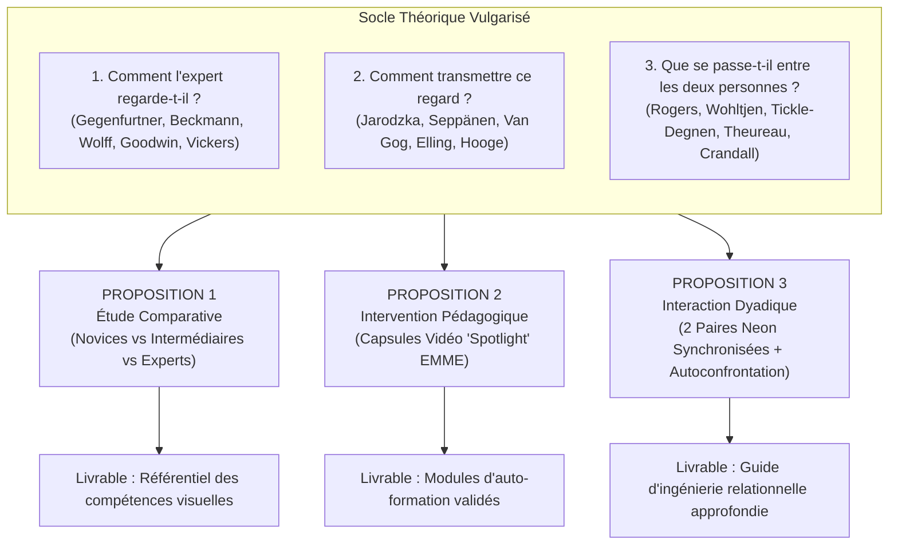

# Guide Méthodologique Approfondi & Opérationnel : Projet SIMACCUEIL

**Projet de Recherche Appliquée Lab-DRA (HECh / HEL)**  
**Programme** : *SIMACCUEIL — Oculométrie Mobile (Pupil Labs Neon), Cognition Située & Pratiques d'Accueil Hôtelier (Upselling & Gestion de Réclamations)*  
**Chercheur Principal** : Jérôme Foguenne  
**Institutions partenaires** : Haute École Charlemagne (HECh) & Haute École de Liège (HEL)  

---

## Avant-propos : Glossaire & Principes Clés Vulgarisés

Pour concilier **rigueur académique** et **clarté opérationnelle**, voici les concepts clés mobilisés tout au long de ce document :

* **Oculométrie mobile (*Eye Tracking* mobile)** : Technique de mesure des mouvements oculaires utilisant des lunettes légères (ici les lunettes **Pupil Labs Neon**). Contrairement aux systèmes fixes sur écran d'ordinateur, ces lunettes permettent au participant de bouger naturellement la tête et le corps, d'interagir avec une personne réelle tout en consultant des outils numériques (ordinateur et tablette).
* **Fixation & Saccade** :
  * Une **fixation** est un arrêt du regard sur un point précis (au moins 100 millisecondes) durant lequel le cerveau prélève et traite l'information visuelle.
  * Une **saccade** est le saut ultra-rapide (20 à 40 millisecondes) que fait l'œil pour passer d'une cible à une autre. Durant la saccade, la vision est temporairement neutralisée par le cerveau (*suppression saccadique*).
* **Zones d'Intérêt (AOI - *Areas of Interest*)** : Régions de l'environnement délimitées par le chercheur pour quantifier l'attention (ex. : l'écran de l'ordinateur, le visage du client, la tablette).
  * *AOI statique* : Zone dont la position ne bouge pas (ex. : la case du tarif affichée sur l'écran fixe).
  * *AOI dynamique* : Zone en mouvement dans l'espace (ex. : les yeux du client qui bouge ou la tablette manipulée par le réceptionniste).
* **Charge cognitive (CLT)** : La quantité d'effort mental mobilisée dans la mémoire de travail à un instant donné.
  * *Charge intrinsèque* : Liée à la difficulté propre de la tâche (ex. : résoudre un litige complexe).
  * *Charge extrinsèque* : Effort inutile provoqué par un outil mal conçu ou une interface informatique confuse (ex. : chercher désespérément un bouton sur un logiciel hôtelier).
  * *Charge utile (*germane*)* : Effort consacré à la compréhension et à l'apprentissage.
* **PMS (*Property Management System*)** : Le logiciel central de gestion hôtelière utilisé par les réceptionnistes pour enregistrer les arrivées (*check-in*), vérifier les disponibilités des chambres et consulter l'historique du client.
* **Upselling** : Pratique commerciale consistant à proposer à un client une prestation de catégorie supérieure à celle qu'il a réservée (ex. : passer d'une chambre standard à une suite junior avec vue), moyennant un supplément tarifaire négocié.
* **EMME (*Eye-Movement Modelling Examples*)** : Méthode d'apprentissage par observation où l'étudiant visionne une vidéo montrant les actions d'un professionnel expert, sur laquelle est superposé en temps réel le tracé de son regard.

---



---

## PROPOSITION 1 : Approche Comparativo-Développementale (Novices vs Intermédiaires vs Experts)

> **Intitulé vulgarisé** : *« Observer pour comprendre : Qu'est-ce qui différencie le regard d'un réceptionniste débutant de celui d'un professionnel expérimenté face à un client ? »*  
> **Intitulé académique** : *« La Vision Professionnelle en Action : Étude comparative transversale de l'allocation attentionnelle, de la charge cognitive et de la performance relationnelle en accueil hôtelier instrumenté »*

---

### 1. Justification Théorique Vulgarisée & Mobilisation de l'État de l'Art

Pourquoi comparer des étudiants débutants, des étudiants de fin de cursus et des professionnels en poste ?

1. **L'œil de l'expert va droit au but** : La grande méta-analyse d'**Andreas Gegenfurtner et ses collègues (2011)** a démontré, sur 73 recherches internationales, que les experts ne regardent pas « plus » de choses, mais regardent **mieux et plus vite**. Un professionnel expérimenté ignore spontanément les détails inutiles pour poser directement son regard sur l'information essentielle (*hypothèse de réduction de l'information*). À la réception d'un hôtel, un débutant risque de scruter frénétiquement tout l'écran de son ordinateur, alors que le professionnel repère en un coup d'œil le profil du voyageur.
2. **Le logiciel monopolise l'esprit du débutant** : Selon le cadre théorique de **Jens Beckmann (2010)**, lorsqu'une personne ne maîtrise pas parfaitement un outil informatique, la manipulation du logiciel sature sa mémoire de travail (forte *charge cognitive extrinsèque*). L'étudiant débutant n'a alors plus assez d'espace mental disponible pour regarder le client et écouter ses besoins. À l'inverse, chez le professionnel, l'utilisation du logiciel est devenue automatique (comme conduire une voiture) : son esprit et ses yeux sont totalement libres pour observer le client et capter ses signaux non verbaux.
3. **Apprendre à voir comme un membre du métier** : **Charles Goodwin (1994)** a mis en évidence le concept de « vision professionnelle » : chaque métier apprend à ses membres à structurer leur regard (*coding schemes* et *highlighting*). **Wolff et al. (2016)** ont illustré cela : les experts développent une vision panoramique et surveillent l'ensemble de la situation, tandis que les novices restent « scotchés » à un seul détail.
4. **Le moment d'arrêt avant la décision (*Quiet Eye*)** : La chercheuse **Joan Vickers (2016)** a montré que juste avant une action décisive, les experts stabilisent leur regard de manière immobile pendant une fraction de seconde sur la cible critique. Dans l'accueil hôtelier, nous faisons l'hypothèse que le réceptionniste expérimenté pose un regard calme et stabilisé sur le tarif ou dans les yeux du client juste avant d'annoncer une offre commerciale ou de répondre à une réclamation, ce qui renforce sa force de persuasion.
5. **Relier la mesure des yeux à la qualité du service** : **Cortina et al. (2015)** ont prouvé que des mesures simples recueillies par des lunettes d'eye tracking (ex. : pourcentage de temps passé à regarder le visage des personnes) correspondent très précisément aux notes attribuées par des observateurs extérieurs experts. Cela garantit que nos mesures oculaires reflètent la réalité de la compétence professionnelle.

---

### 2. Plan Opérationnel du Projet de Recherche (Phasage Détaillé sur 12 Mois)

```
Mois 01-02 [■■■■] Phase 1 : Cadrage, Scénarisation & Test Pilote
Mois 03-05 [    ■■■■■■] Phase 2 : Collecte des Données Expérimentales (60 Sujets)
Mois 06-08 [          ■■■■■■] Phase 3 : Traitement Automatisé des Données (Vision par Ordinateur)
Mois 09-12 [                ■■■■■■■■] Phase 4 : Analyses Statistiques & Référentiel HECh
```

#### Étape 1 : Cadrage des scénarios et calibration technique (Mois 1 à 2)
* **Création des deux scénarios standardisés** :
  * *Scénario A (Upselling multicanal - Denizci Guillet, 2020)* : Le client arrive pour un séjour d'affaires de 2 nuits. Il a réservé une chambre standard. Sur le PMS, une alerte indique qu'il a consulté en ligne la suite exécutive sans l'acheter. Le réceptionniste doit vérifier cette info, proposer le surclassement à prix préférentiel et lui montrer les photos sur la tablette.
  * *Scénario B (Gestion de réclamation - Ruki, 2023)* : Le client arrive mécontent : sa chambre n'est pas prête alors que l'heure de check-in est dépassée, et il a un rendez-vous urgent. Le réceptionniste doit chercher une solution immédiate sur le PMS tout en restant empathique et calme.
* **Standardisation du client simulé** : Recrutement et formation de 2 comédiens professionnels chargés de jouer le client avec une rigueur absolue (mêmes intonations, mêmes répliques mot à mot, mêmes moments de silence).
* **Étude pilote (4 participants)** : Ajuster les marges de détection des lunettes Pupil Labs Neon sur l'écran et la tablette selon les recommandations méthodologiques de **Hooge et al. (2024)**.

#### Étape 2 : Recueil des données sur 60 participants (Mois 3 à 5)
* **Trois groupes de participants contrastés** :
  * *Groupe 1 : 20 Novices* (étudiants de 1re année Bachelier Gestion Hôtelière HECh/HEL, n'ayant jamais fait de stage).
  * *Groupe 2 : 20 Intermédiaires* (étudiants de 3e année Bachelier ayant validé leurs stages de réception).
  * *Groupe 3 : 20 Experts* (réceptionnistes en activité, minimum 3 ans d'ancienneté en hôtels 4* ou 5*).
* **Déroulement d'une passation individuelle (durée totale : 35 minutes par sujet)** :
  1. *Accueil & Équipement (5 min)* : Explication du protocole, signature du consentement éclairé (RGPD), installation des lunettes Pupil Labs Neon sur le nez du participant. Vérification du calibrage oculaire automatique.
  2. *Consigne professionnelle (3 min)* : Fiche de poste remise au participant détaillant le contexte de l'hôtel virtuel et les standards attendus.
  3. *Simulation Scénario A - Upselling (7 min)* : Interaction libre avec le client comédien sous enregistrement synchronisé (yeux à 200 Hz, vidéo de scène HD, audio micro-cravate et logs informatiques).
  4. *Pause & Changement de consigne (3 min)*.
  5. *Simulation Scénario B - Réclamation (7 min)* : Même dispositif avec le cas d'insatisfaction.
  6. *Questionnaire d'effort mental (5 min)* : Remplissage immédiat d'une échelle de charge mentale subjective (*Complexity Framework* de **Beckmann, 2010**).
  7. *Déséquipement et remerciements (5 min)*.

#### Étape 3 : Traitement des données & Vision par Ordinateur (Mois 6 à 8)
* Découpage semi-automatique des vidéos à l'aide de l'algorithme de détection d'objets et de visages développé par **De Beugher, Brône et Goedemé (2014)**. Le script informatique identifie automatiquement dans chaque image de la vidéo où se trouvent l'écran du PMS, la tablette et les yeux du client, évitant ainsi des centaines d'heures d'annotation manuelle.
* Évaluation de la qualité de la relation par 2 experts enseignants en aveugle (qui notent les vidéos sans savoir si le participant est étudiant ou professionnel) à l'aide d'une grille adaptée du protocole CLASS (**Cortina et al., 2015**).

#### Étape 4 : Analyses statistiques et livrables (Mois 9 à 12)
* Tests statistiques de comparaison (ANOVA à mesures répétées) pour vérifier quelles mesures oculaires séparent nettement les experts des débutants.
* Rédaction d'un **Guide des Bonnes Pratiques Visuelles en Réception** pour les étudiants de l'HECh.

---

### 3. Objectifs Spécifiques et Résultats Attendus

* **Objectif 1** : Mesurer précisément la part de temps consacrée à l'écran par rapport au client.  
  *Résultat attendu* : Les débutants passeront plus de $65\%$ du temps les yeux fixés sur le logiciel hôtelier, contre moins de $30\%$ pour les professionnels experts.
* **Objectif 2** : Évaluer la rapidité de détection des opportunités commerciales.  
  *Résultat attendu* : Les experts repéreront l'information utile sur l'écran (*Time to First Fixation*) en moins de 1,5 seconde, contre plus de 6 secondes chez les débutants.
* **Objectif 3** : Prouver l'existence d'un temps d'arrêt visuel (*Quiet Eye*) garantissant le sang-froid et la persuasion.  
  *Résultat attendu* : Une fixation stable sur le client d'au moins 350 ms avant d'annoncer le prix d'un surclassement augmentera significativement les chances d'acceptation de l'offre.

---

### 4. Grille Complète des Indicateurs Opérationnels (Proposition 1)

| Dimension mesurée | Nom vulgarisé de l'indicateur | Comment est-il calculé ? | Qu'est-ce que cela révèle sur l'activité ? | Référence clé État de l'Art |
| :--- | :--- | :--- | :--- | :--- |
| **Captation logicielle** | **Temps passé sur l'écran PMS (%)** | $\frac{\text{Temps de fixation sur l'écran}}{\text{Durée totale de l'accueil}} \times 100$. | Mesure si le réceptionniste est « prisonnier » de son outil informatique ou s'il est disponible pour son client. | **Beckmann (2010)** (Charge cognitive extrinsèque) |
| **Vitesse de repérage** | **Temps pour trouver l'info clé (ms)** | Chronomètre entre l'affichage de la réservation et la 1re fixation sur le statut de la chambre. | Démontre si l'opérateur sait où chercher sans hésiter (*vision sélective*). | **Gegenfurtner et al. (2011)** (Modèle holistique) |
| **Équilibre relationnel** | **Ratio Visage / Écran** | $\frac{\text{Temps passé à regarder le client}}{\text{Temps passé à regarder l'écran}}$. | Un ratio $< 0.5$ signale une communication rompue ; un ratio $> 1.2$ montre une relation prépondérante. | **Wolff et al. (2016)** (Vision distribuée) |
| **Stabilité décisionnelle** | **Durée du regard fixe avant parole (*Quiet Eye*)** | Durée (en millisecondes) de la fixation immobile juste avant de parler pour proposer le surclassement. | Indique le temps de préparation mentale et de contrôle émotionnel avant l'argumentation. | **Vickers (2016)** (Quiet Eye) |
| **Chaleur non verbale** | **Fréquence des sourires sincères** | Nombre de sourires authentiques (yeux plissés, Duchenne) relevés sur la vidéo de face. | Différencie l'accueil chaleureux naturel du simple masque commercial stéréotypé. | **Hennig-Thurau et al. (2006)** (Sourires authentiques) |
| **Qualité perçue** | **Note globale de relation client** | Score de 1 à 7 évaluant l'écoute, la politesse et la coordination du réceptionniste. | Permet de vérifier si les participants qui regardent le mieux le client sont aussi les mieux notés. | **Cortina et al. (2015)** & **Tickle-Degnen (1990)** |
| **Réussite commerciale** | **Taux de succès de l'upselling** | Résultat binaire : Surclassement accepté (Oui / Non) et montant du supplément engrangé. | Mesure la rentabilité concrète de l'action commerciale menée par le réceptionniste. | **Denizci Guillet (2020)** & **Ruki (2023)** |

---

## PROPOSITION 2 : Approche Didactique & Vicariante (Interventionnelle par EMME)

> **Intitulé vulgarisé** : *« Apprendre à travers les yeux d'un expert : Des capsules vidéo montrant le regard d'un professionnel permettent-elles aux étudiants de mieux réussir l'accueil ? »*  
> **Intitulé académique** : *« Ingénierie Pédagogique par Modélisation du Regard (EMME) : Évaluation de l'impact d'un guidage attentionnel "Spotlight" sur l'apprentissage des compétences d'accueil hôtelier »*

---

### 1. Justification Théorique Vulgarisée & Mobilisation de l'État de l'Art

Pourquoi utiliser des vidéos enrichies du regard de l'expert pour former les étudiants ?

1. **Rendre visible l'invisible sans distraire** : Les recherches de **Halszka Jarodzka et ses collègues (2012)** ont montré que dans des métiers visuellement denses, les enseignants peinent à expliquer verbalement tout ce qu'ils observent. En superposant le tracé oculaire de l'expert sur une vidéo de formation (*Eye-Movement Modelling Examples* - EMME), l'apprenant découvre les raccourcis visuels du professionnel. Cependant, afficher un simple cercle rouge mobile distrait l'étudiant. Jarodzka et al. ont prouvé que la technique du **spotlight** (la zone fixée par l'expert reste claire et nette, tandis que le reste de la scène est légèrement estompé dans la pénombre) guide le regard de l'étudiant avec douceur, sans rompre la compréhension d'ensemble.
2. **Accélérer l'apprentissage de l'interprétation** : **Marko Seppänen et Andreas Gegenfurtner (2012)** ont confirmé que voir une situation à travers les yeux d'un formateur expérimenté permet aux étudiants d'apprendre plus vite à scanner une interface complexe et évite les erreurs d'inattention.
3. **Attention au piège de la redondance** : L'équipe de **Tamara van Gog et John Sweller (2009)** a sonné une alerte capitale : si l'on montre le regard de l'expert tout en bombardant l'étudiant de longs discours audio compliqués, le cerveau sature (*effet de redondance*). Les capsules d'apprentissage doivent donc être courtes, rythmées et ciblées sur des gestes professionnels précis.
4. **Le silence de l'étudiant comme thermomètre mental** : **Sanne Elling et ses coauteurs (2012)** ont révélé que lorsque des usagers se taisent face à un écran (représentant plus d'un quart du temps total), c'est souvent le signe qu'ils sont bloqués ou submergés cognitivement. Réduire les silences gênés de l'étudiant devant son client est l'une des preuves que la formation a réussi.

---

### 2. Plan Opérationnel du Projet de Recherche (Phasage Détaillé sur 10 Mois)

```
Mois 01-03 [■■■■■■] Phase 1 : Tournage Expert & Production Algorithmique "Spotlight"
Mois 04-06 [      ■■■■■■] Phase 2 : Essai Pédagogique Randomisé (50 Étudiants : Pré-test / Formation / Post-test)
Mois 07-08 [            ■■■■] Phase 3 : Calcul des Gains Pédagogiques & Traitement des Silences
Mois 09-10 [                ■■■■] Phase 4 : Intégration dans les Cours HECh / HEL & Guide Formateur
```

#### Étape 1 : Création de la bibliothèque de capsules « Spotlight » (Mois 1 à 3)
* **Enregistrement du modèle expert** : Un réceptionniste confirmé (lauréat de concours ou chef de réception 5*) est équipé des lunettes Pupil Labs Neon. Il joue 4 situations modèles d'accueil (2 cas d'upselling réussis avec tablette et 2 cas de réclamations résolues avec élégance).
* **Développement informatique du filtre Spotlight** : Traitement automatique des vidéos par script Python. Chaque trame vidéo est traitée pour générer un cercle lumineux de focalisation net de $3^\circ$ centré sur l'endroit exact où le professionnel pose ses yeux, le reste de l'écran ou de la pièce recevant un voile flou de $40\%$.
* **Scénarisation didactique** : Chaque capsule dure exactement 2 minutes 30, avec une voix off sobre qui n'intervient que pour expliquer la justification de l'action (*« Ici, je repère que le client est venu en train, je vais lui proposer un départ tardif »*).

#### Étape 2 : L'essai comparatif auprès des étudiants (Mois 4 à 6)
* **Recrutement** : 50 étudiants de Bachelier en Gestion Hôtelière de l'HECh/HEL.
* **Tirage au sort (Randomisation)** :
  * *25 étudiants dans le Groupe Expérimental (Formation Spotlight EMME)*.
  * *25 étudiants dans le Groupe Contrôle (Formation Traditionnelle)*.
* **Le protocole en trois temps** :
  1. *Pré-test ($T_0$)* : Les 50 étudiants passent individuellement une mise en situation d'accueil de 6 minutes avec les lunettes Pupil Labs Neon. On enregistre leur comportement initial face à un client simulé.
  2. *Période d'apprentissage (3 semaines)* :
     * Le groupe expérimental suit le module numérique avec les 4 capsules vidéo *Spotlight*.
     * Le groupe contrôle suit un module sur les mêmes situations, avec les mêmes vidéos mais *sans l'effet de regard spotlight*, accompagnées de fiches mémo écrites classiques.
  3. *Post-test ($T_1$)* : Tous les étudiants repassent une simulation équivalente mais avec un scénario inédit sous les lunettes Neon.

#### Étape 3 : Mesure des progrès et des silences (Mois 7 à 8)
* Calcul du différentiel de progression pour chaque étudiant : $\Delta = \text{Score } T_1 - \text{Score } T_0$.
* Analyse spécifique des temps de silence à l'aide de la méthodologie d'**Elling et al. (2012)** : vérification de la baisse des moments où l'étudiant ne parle plus au client parce qu'il est perdu dans son logiciel.
* Mesure de la fatigue cognitive ressentie à l'aide de l'échelle standardisée de Paas (questionnaire en 9 points).

#### Étape 4 : Déploiement dans les cursus (Mois 9 à 10)
* Mise à disposition des capsules vidéo sur la plateforme Moodle de l'HECh et de l'HEL.
* Organisation d'une journée de partage pédagogique pour les enseignants de langues et de techniques d'accueil de la Haute École.

---

### 3. Objectifs Spécifiques et Résultats Attendus

* **Objectif 1** : Réduire le temps d'apprentissage nécessaire pour devenir fluide sur le logiciel d'accueil.  
  *Résultat attendu* : Les étudiants formés avec le *Spotlight* réduiront de $40\%$ le temps perdu à chercher des rubriques dans le PMS dès leur premier essai post-formation.
* **Objectif 2** : Augmenter la présence relationnelle et l'attention portée au client.  
  *Résultat attendu* : Le groupe *Spotlight* passera en moyenne $45\%$ de temps en plus à regarder le client dans les yeux pendant les négociations de prix que le groupe contrôle.
* **Objectif 3** : Éliminer les silences de panique face au client.  
  *Résultat attendu* : Une division par deux de la durée cumulée des silences de blocage face au voyageur.

---

### 4. Grille Complète des Indicateurs Opérationnels (Proposition 2)

| Indicateur d'apprentissage | Formulation concrète | Méthode de calcul | Ce que l'indicateur valide | Référence clé État de l'Art |
| :--- | :--- | :--- | :--- | :--- |
| **Gain d'attention client** | **Augmentation du regard vers le client ($\Delta RC$)** | $\% \text{ Temps Client en } T_1 - \% \text{ Temps Client en } T_0$. | Valide que l'étudiant ose enfin lever les yeux de son ordinateur pour regarder le voyageur. | **Jarodzka et al. (2012)** (Apprentissage par Spotlight) |
| **Gain de fluidité logicielle** | **Baisse des errances sur l'écran ($\Delta EP$)** | Temps passé à balayer l'écran inutilement en $T_0$ moins ce temps en $T_1$. | Démontre que la modélisation du regard a enseigné la trajectoire visuelle directe sur le logiciel. | **Seppänen & Gegenfurtner (2012)** (Guidage enseignant) |
| **Baisse du stress mental** | **Diminution des silences bloquants** | Nombre et durée cumulée des silences $> 2\text{ s}$ où l'étudiant a le regard figé sur l'écran. | Prouve que l'étudiant ne subit plus de surcharge mentale bloquant son élocution face au client. | **Elling et al. (2012)** (Analyse des silences) |
| **Effort mental ressenti** | **Score d'allègement cognitif** | Différence de note sur l'échelle de Paas (1 = aucune difficulté à 9 = effort écrasant). | Confirme que le guidage n'a pas surchargé l'esprit de l'étudiant et a rendu la tâche plus facile. | **Van Gog et al. (2009)** & **Beckmann (2010)** |
| **Réussite de l'offre** | **Score de persuasion en upselling** | Grille sur 20 points évaluant la mise en valeur des avantages de la chambre sur la tablette. | Mesure la transformation de l'aisance visuelle en performance commerciale concrète. | **Ruki (2023)** & **Otterbring et al. (2014)** |
| **Maîtrise de la réclamation** | **Score d'écoute et de désescalade** | Note sur 20 portant sur l'attitude calme, l'absence de coupure de parole et la solution trouvée. | Démontre la capacité de l'étudiant à gérer un conflit sans se réfugier derrière son écran. | **Tickle-Degnen & Rosenthal (1990)** |

---

## PROPOSITION 3 : Approche Énactive & Interactionnelle Dyadique (Dual Eye Tracking & Cours d'Action)

> **Intitulé vulgarisé** : *« Se regarder, se comprendre, s'écouter : Que se passe-t-il vraiment dans les yeux et dans la tête du réceptionniste et du client pendant qu'ils se parlent ? »*  
> **Intitulé académique** : *« Énaction et Synchronie Sociale : Analyse dyadique de l'interaction d'accueil hôtelier par double oculométrie mobile synchronisée et entretiens d'autoconfrontation du cours d'action »*

---

### 1. Justification Théorique Vulgarisée & Mobilisation de l'État de l'Art

Pourquoi équiper le client ET le réceptionniste de lunettes en même temps, puis faire un entretien de débriefing ?

1. **La communication est une danse à deux** : **Shane Rogers et ses collègues (2018)** ont fait une découverte fondamentale grâce au *dual eye tracking* (deux personnes équipées d'eye trackers face-à-face) : les êtres humains ne se regardent pas dans les yeux en continu ! Le contact visuel direct mutuel est rare et bref. Lorsque nous parlons et réfléchissons à ce que nous allons dire, nous détournons naturellement les yeux pour réfléchir tranquillement sans être distraits par le visage de l'autre. Il est donc totalement normal qu'un réceptionniste regarde son écran ou sa table ; l'important est de savoir **à quel moment précis** il réétablit le contact visuel.
2. **Le regard marque le tempo de l'attention partagée** : Dans une étude publiée dans la prestigieuse revue *PNAS*, **Sophie Wohltjen et Thalia Wheatley (2021)** démontrent que le contact visuel entre deux personnes marque le **sommet de leur connexion attentionnelle**. Mais juste après s'être regardés dans les yeux, les deux interlocuteurs brisent le regard : cette rupture est nécessaire pour permettre à chacun de développer une pensée personnelle avant de reprendre la parole. En réception d'hôtel, alterner entre le client et la tablette d'upselling n'est pas un défaut : c'est la respiration naturelle de la conversation.
3. **Le rapport interpersonnel ne se décrète pas, il se synchronise** : **Tickle-Degnen et Rosenthal (1990)** ont modélisé le « rapport » (le sentiment de sympathie et d'harmonie mutuelle). Il repose sur trois piliers : l'attention mutuelle, la positivité et la coordination gestuelle. Deux paires de lunettes permettent de mesurer si le client et le réceptionniste regardent la tablette en même temps au moment où l'offre est expliquée.
4. **Comprendre ce que la personne a vécu de l'intérieur (*Le Cours d'Action*)** : Mesurer des mouvements d'yeux ne dit pas *pourquoi* la personne a regardé là. Le grand chercheur français **Jacques Theureau (recensé par Marc Durand, 2016)** a développé la méthode du **cours d'action**. Juste après la simulation, l'étudiant visionne la vidéo de ce qu'il a vu avec son regard enregistré, et le chercheur l'invite à raconter ce qu'il ressentait, pensait et craignait à chaque instant (*entretien d'autoconfrontation*).
5. **Faire émerger les intuitions cachées** : En utilisant les techniques de relance de **Beth Crandall, Gary Klein et Robert Hoffman (2006)** (*Cognitive Task Analysis*), le chercheur amène l'étudiant à verbaliser des réflexes inconscients : *« Pourquoi as-tu hésité à ce moment-là ? Qu'as-tu lu sur le visage du client qui t'a fait renoncer à proposer le supplément ? »*.

---

### 2. Plan Opérationnel du Projet de Recherche (Phasage Détaillé sur 12 Mois)

```
Mois 01-02 [■■■■] Phase 1 : R&D Technique (Synchronisation 2x Neon & Comptoir Écologique)
Mois 03-05 [    ■■■■■■] Phase 2 : 20 Simulations Dyadiques & 20 Entretiens d'Autoconfrontation
Mois 06-08 [          ■■■■■■] Phase 3 : Modélisation Mixte (Courbes de Synchronie + Verbatim)
Mois 09-12 [                ■■■■■■■■] Phase 4 : Modèle Énactif de l'Accueil & Monographie Lab-DRA
```

#### Étape 1 : Mise au point technologique de la synchronisation (Mois 1 à 2)
* **Couplage des deux paires de lunettes Pupil Labs Neon** : Mise en place d'un réseau Wi-Fi local dédié de haute précision avec protocole de synchronisation temporelle NTP (*Network Time Protocol*). Ce réglage garantit que l'enregistrement des yeux du réceptionniste et celui du client sont calés à la milliseconde près.
* **Agencement ergonomique du comptoir** : Installation d'un vrai comptoir de réception d'hôtel avec un écran PMS positionné sur le côté et une tablette tactile centrale orientable, selon les recommandations d'**Otterbring et al. (2014)** sur l'attention visuelle en espace commercial.

#### Étape 2 : Recueil des données dyadiques et entretiens immédiats (Mois 3 à 5)
* **Échantillon** : 20 binômes complets (20 étudiants de dernière année en Gestion Hôtelière face à 5 clients standardisés aux profils psychologiques contrastés : le client pressé, le client tatillon, le client indécis).
* **Déroulement d'une session expérimentale (durée totale : 1 heure 15 par étudiant)** :
  1. *Équipement simultané (10 min)* : Le réceptionniste et le client enfilent chacun leurs lunettes Neon. Les deux flux vidéo sont synchronisés et contrôlés sur l'écran de régie du chercheur.
  2. *Mise en situation écologique (15 min)* :
     * Première partie : Accueil, identification de la réservation et tentative d'upselling sur la tablette (cas **Denizci Guillet, 2020**).
     * Seconde partie : Arrivée impromptue d'une réclamation imprévue (découverte d'un problème de facturation ou de confort).
  3. *Transition immédiate vers la salle de débriefing (5 min)* : L'étudiant retire ses lunettes et s'assied avec le chercheur devant un grand écran.
  4. *Entretien d'autoconfrontation du cours d'action (45 min)* : Le chercheur diffuse la vidéo subjective enregistrée par les lunettes de l'étudiant. La vidéo est arrêtée sur les moments de rupture, d'hésitation ou de regard croisé. Le chercheur pose des questions ouvertes neutres : *« Qu'est-ce que tu fais là ? Que regardes-tu ? Qu'est-ce qui te passe par la tête ? Qu'est-ce qui te fait décider de baisser les yeux vers ton écran ? »* (**Theureau / Durand, 2016** ; **Crandall et al., 2006**).

#### Étape 3 : Traitement des données et modélisation mixte (Mois 6 à 8)
* **Calcul des croisements de regard** : Un algorithme calcule les moments exacts où les deux lignes de regard se croisent (quand les deux personnes se regardent dans les yeux) et les moments de co-attention (quand leurs deux regards convergent sur la même photo de chambre sur la tablette).
* **Découpage des entretiens** : Transcription intégrale des paroles de l'étudiant découpées en « unités d'action-signe » (ce que l'étudiant ressent, ce qu'il perçoit, ce qu'il fait).

#### Étape 4 : Synthèse et publication (Mois 9 à 12)
* Mise en relation des courbes de synchronisation visuelle avec le vécu émotionnel des étudiants.
* Rédaction d'une monographie méthodologique pour le Lab-DRA et soumission d'un article majeur dans une revue de psychologie ergonomique ou d'interaction homme-machine (*Human-Computer Interaction* ou *Activités*).

---

### 3. Objectifs Spécifiques et Résultats Attendus

* **Objectif 1** : Cartographier pour la première fois la chorégraphie réelle des regards dans un échange de service hôtelier.  
  *Résultat attendu* : Démontrer que le regard direct dans les yeux ne représente que $15$ à $25\%$ du temps d'échange, et qu'il intervient principalement comme un signal d'écoute ou de conclusion d'accord.
* **Objectif 2** : Identifier les moments où la tablette crée une « attention partagée » bénéfique pour la vente.  
  *Résultat attendu* : Montrer que les propositions d'upselling qui réussissent sont celles où le réceptionniste réussit à créer au moins 3 épisodes de co-attention synchronisée sur la tablette avec son client (**Wohltjen & Wheatley, 2021**).
* **Objectif 3** : Comprendre les dilemmes intérieurs des étudiants lors d'une réclamation.  
  *Résultat attendu* : Mettre en lumière la peur du regard de l'autre qui pousse souvent l'étudiant novice à se réfugier les yeux rivés sur son écran d'ordinateur pour fuir la tension relationnelle.

---

### 4. Grille Complète des Indicateurs Opérationnels (Proposition 3)

| Dimension dyadique | Nom vulgarisé | Comment est-il mesuré ? | Ce que cela nous apprend | Référence clé État de l'Art |
| :--- | :--- | :--- | :--- | :--- |
| **Contact oculaire mutuel** | **Temps de regard les yeux dans les yeux (%)** | Intersection mathématique des deux vecteurs de regard dans la zone des yeux de l'autre. | Révèle la fréquence réelle des moments d'ancrage visuel direct et leur durée moyenne. | **Rogers et al. (2018)** (Dual Eye Tracking) |
| **Attention partagée** | **Temps de regard commun sur la tablette** | Durée totale où les deux paires de lunettes fixent en même temps la tablette d'upselling ($\pm 200\text{ ms}$). | Marqueur de l'attention conjointe : le client et le vendeur regardent ensemble l'offre commerciale. | **Wohltjen & Wheatley (2021)** & **Otterbring (2014)** |
| **Réactivité à la parole** | **Délai de retour du regard à la prise de parole** | Temps (en ms) que met le réceptionniste à lever les yeux vers le client dès que celui-ci commence à parler. | Mesure la vivacité de l'écoute active : le client se sent-il écouté dès qu'il prend la parole ? | **Tickle-Degnen & Rosenthal (1990)** (Coordination) |
| **Authenticité affective** | **Délai de contagion du sourire** | Temps qui s'écoule entre le sourire bienveillant du réceptionniste et le relâchement des traits du client. | Teste l'efficacité de la contagion émotionnelle primitive face à une réclamation tendue. | **Hennig-Thurau et al. (2006)** (Contagion émotionnelle) |
| **Expérience vécue (Énaction)** | **Unité d'Action-Signe (UAS)** | Découpage des paroles de l'étudiant en autoconfrontation (ses intentions, ses peurs, ses actions). | Permet de comprendre le sens que l'étudiant donnait à son comportement à chaque seconde. | **Theureau / Durand (2016)** (Cours d'action) |
| **Savoirs tacites** | **Dilemmes décisionnels exprimés** | Nombre de conflits intérieurs verbalisés (ex. : « J'avais peur de paraître insistant en proposant le supplément »). | Met au jour les freins psychologiques et commerciaux qui bloquent la compétence d'upselling. | **Crandall, Klein & Hoffman (2006)** (Méthode CDM) |

---

## Tableau Comparatif Global et Guide de Choix pour Jérôme Foguenne

| Critères d'arbitrage | Proposition 1 : Comparatif Experts/Novices | Proposition 2 : Didactique Vicariante (EMME) | Proposition 3 : Dyadique & Cours d'Action |
| :--- | :--- | :--- | :--- |
| **Faisabilité matérielle** | **Très simple** (1 paire de lunettes Neon, 1 ordinateur PMS). | **Simple** (1 paire de lunettes Neon, tournage de capsules). | **Technique** (2 paires de lunettes Neon synchronisées en Wi-Fi). |
| **Recrutement des participants** | Nécessite de faire venir 20 professionnels d'hôtels partenaires. | **Très aisé** (réalisé avec les étudiants des promotions HECh/HEL). | **Aisé** (20 étudiants et comédiens formés). |
| **Durée globale du projet** | 12 mois. | **10 mois (le plus rapide)**. | 12 mois. |
| **Impact pédagogique direct** | Fournit une grille d'évaluation pour les examens de réception. | **Immédiat et concret** : Création d'un module de cours complet sur Moodle. | Révolutionne la façon dont les enseignants font les débriefings de simulation. |
| **Potentiel de publication** | Très fort dans les revues d'hospitalité (*IJHM*, *Annals of Tourism Research*). | Très fort dans les revues d'éducation (*Instructional Science*, *Computers & Education*). | Exceptionnel dans les revues d'ergonomie et d'interaction (*PNAS*, *Activités*). |

---

### 🎯 La Recommandation Opérationnelle

1. **Option Recommandée pour l'HECh (Impact Formation Immédiat)** :  
   Si votre priorité est de valoriser immédiatement l'achat de vos lunettes Pupil Labs Neon auprès de votre direction et de vos étudiants en créant un outil de cours innovant, choisissez la **PROPOSITION 2 (Intervention Didactique EMME Spotlight)**. En 10 mois, vous disposez d'un dispositif pédagogique novateur, testé scientifiquement et utilisable chaque année avec vos étudiants.

2. **Option Recommandée pour la Recherche Pure (Publications Internationales)** :  
   Si votre objectif prioritaire est de positionner le Lab-DRA au plus haut niveau scientifique pour attirer des financements de recherche externe, commencez par la **PROPOSITION 1 (Comparatif Experts/Novices)** en Année 1. Elle posera les bases objectives indispensables pour aborder ensuite la **PROPOSITION 3 (Dyadique)** dans le cadre d'un doctorat ou d'un projet de recherche pluriannuel d'envergure.
