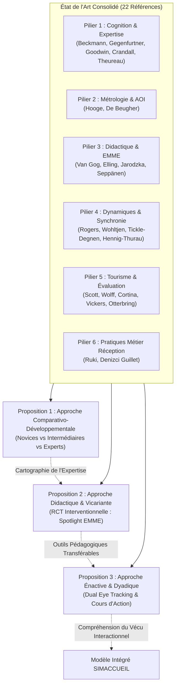
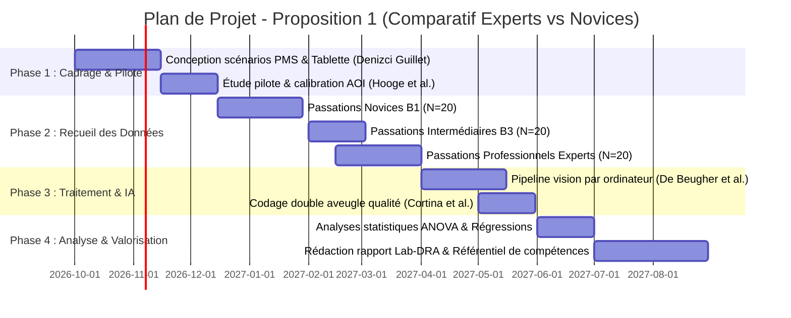
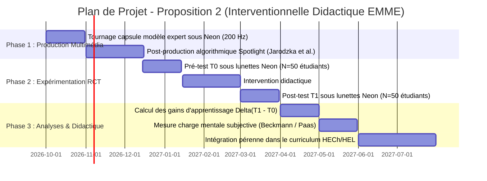
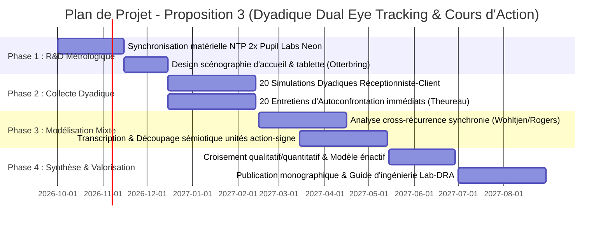

# Document d'Orientation Méthodologique Approfondi : Projet SIMACCUEIL

**Projet de Recherche Appliquée Lab-DRA (HECh / HEL)**  
**Intitulé du Programme** : *SIMACCUEIL — Oculométrie Mobile (Pupil Labs Neon), Cognition Située & Pratiques d'Accueil Hôtelier (Upselling & Gestion de Réclamations)*  
**Chercheur Principal** : Jérôme Foguenne  
**Institution de Rattachement** : Haute École Charlemagne (HECh) & Haute École de Liège (HEL)  

---

## Introduction & Posture Épistémologique Globale

Le projet de recherche appliquée **SIMACCUEIL** se propose d'explorer la boîte noire cognitive, perceptive et interactionnelle de la relation de service au comptoir d'accueil hôtelier (*front desk*). Deux situations professionnelles à fort enjeu relationnel, économique et réputationnel constituent le cœur des expérimentations :
1. **La négociation commerciale d'un surclassement (*upselling*)** dans un environnement multicanal intégrant le logiciel de gestion hôtelière (*Property Management System* - PMS) et un support visuel interactif (tablette tactile).
2. **Le traitement bienveillant et apaisant d'une réclamation client (*complaint handling*)** face à un voyageur insatisfait, exigeant une régulation émotionnelle fine, une écoute active non verbale et des arbitrages tarifaires ou compensatoires rapides.

Pour répondre aux exigences d'un projet de recherche en Haute École orienté vers l'innovation pédagogique et le transfert professionnel, **trois méthodologies complètes, autonomes et complémentaires** sont formalisées ci-dessous. Chacune adopte un ancrage épistémologique spécifique, justifie rigoureusement chaque choix au regard de l'état de l'art consolidé (22 références), détaille son plan de travail opératoire, définit ses objectifs et formalise une grille exhaustive d'indicateurs exploitables.

---

---

## PROPOSITION 1 : Approche Comparativo-Développementale (Experts vs Novices)

> **Titre de la Recherche** : *« La Vision Professionnelle en Action : Étude comparative transversale de l'allocation attentionnelle, de la charge cognitive et de la performance relationnelle en accueil hôtelier instrumenté »*

### 1. Justification Détaillée des Choix Scientifiques (Ancrage État de l'Art)

Cette première méthodologie s'inscrit dans le paradigme de la **psychologie cognitive de l'expertise** et du **Naturalistic Decision Making (NDM)**. Le choix d'un design comparatif transversal repose sur des fondements empiriques solides :

* **Théories universelles du regard expert** : La méta-analyse de **Gegenfurtner, Lehtinen et Säljö (2011)** démontre, sur 73 études oculométriques, que les experts se distinguent par des fixations plus courtes, une réduction drastique de l'attention portée aux éléments redondants (*information reduction hypothesis*) et un traitement parafovéal étendu (*holistic model*). Transposé à l'accueil hôtelier, l'opérateur chevronné ne balaye pas l'écran au hasard : il accède immédiatement aux données critiques.
* **Cadre de complexité et charge cognitive** : **Beckmann (2010)** a démontré que la charge mentale résulte de la rencontre entre les exigences objectives d'une tâche, les conditions de la situation et la mémoire de travail de l'opérateur. En réception, la manipulation du PMS constitue une tâche cognitivement écrasante pour le novice. Comme le relèvent les constats de terrain, l'automatisation de la manipulation logicielle (routinisation procédurale) chez l'expert libère des ressources en mémoire de travail, permettant d'orienter le regard vers le client.
* **La vision professionnelle comme compétence située** : **Goodwin (1994)** prouve que la perception experte repose sur des « schémas de codage » et la « mise en évidence » (*highlighting*). L'expert sait *quoi* regarder et *comment* l'interpréter. L'étude de **Wolff et al. (2016)** en gestion de classe confirme que les experts déploient une vision panoramique et distribuée, détectant les précurseurs d'incidents, tandis que les novices s'enferment dans des détails anecdotiques.
* **Validation de la qualité par convergence de données** : **Cortina et al. (2015)** ont établi la validité écologique de l'oculométrie mobile en montrant que les données biométriques objectives (*low-inference data*, ex. temps de regard vers les visages) convergent statistiquement avec les grilles d'évaluation qualitative de la relation (*high-inference data*).
* **Le phénomène du Quiet Eye** : **Vickers (2016)** a théorisé le *Quiet Eye* (fixation stable avant une action décisive). L'hypothèse testée ici est que le réceptionniste expert stabilise son regard sur l'indice clé (tarif ou regard du client) juste avant de formuler verbalement l'offre d'upselling ou la solution à une réclamation.
* **Ancrage métier de l'upselling** : Les scénarios intègrent les compétences hôtelières identifiées par **Ruki (2023)** au Ritz-Carlton Bali (procédures, maîtrise produit, communication persuasive) et la gestion multicanale documentée par **Denizci Guillet (2020)**.

---

### 2. Plan du Projet de Recherche (Phasage & Calendrier)

Le projet s'échelonne sur **12 mois** répartis en 4 phases opérationnelles :

* **Phase 1 : Cadrage ergonomique et étude pilote (Mois 1 à Mois 2)**
  * Scénarisation fine des deux micro-situations (Upselling multicanal et Réclamation chambre).
  * Implémentation du PMS expérimental et de la tablette client.
  * Test pilote sur 4 participants pour calibrer les marges de tolérance des AOI selon les prescriptions de **Hooge et al. (2024)**.
* **Phase 2 : Collecte des données expérimentales (Mois 3 à Mois 6)**
  * Passation des 60 participants sous lunettes Pupil Labs Neon (20 Novices B1, 20 Intermédiaires B3, 20 Experts confirmés d'hôtels 4*-5*).
  * Enregistrement synchronisé : flux oculaire Neon (200 Hz), vidéo de scène HD, audio haute fidélité, logs du PMS et caméra grand-angle de contexte.
* **Phase 3 : Traitement des données et vision par ordinateur (Mois 7 à Mois 8)**
  * Déploiement d'un pipeline d'extraction automatique des AOI par vision par ordinateur (*Object & Face Detection*) inspiré de **De Beugher, Brône et Goedemé (2014)** pour automatiser le traitement des flux vidéo.
  * Évaluation qualitative des simulations par double codage en aveugle via une grille de qualité de service adaptée du protocole CLASS (**Cortina et al., 2015**).
* **Phase 4 : Analyses statistiques et valorisation (Mois 9 à Mois 12)**
  * Analyses de variance (ANOVA / MANOVA) et régressions multiples reliant métriques oculaires, expertise et performance commerciale.
  * Rédaction du référentiel métrologique des compétences visuelles pour la section hôtelière de l'HECh/HEL et soumission d'un article aux *Annals of Tourism Research* (**Scott et al., 2019**).

---

### 3. Objectifs Stratégiques et Opérationnels

* **Objectif Scientifique 1** : Démontrer empiriquement l'existence d'une « signature oculomotrice experte » en réception hôtelière, caractérisée par une réduction du temps de fixation sur le PMS et une allocation sélective prioritaire vers le client.
* **Objectif Scientifique 2** : Établir la corrélation statistique entre la stabilité de la fixation terminale (*Quiet Eye*) avant une proposition d'upselling et le taux d'acceptation de l'offre par le client.
* **Objectif Pédagogique 3** : Fournir au Lab-DRA et aux enseignants de l'HECh une grille diagnostique objective permettant de mesurer le degré d'automatisation des compétences d'accueil chez les étudiants avant leur départ en stage.

---

### 4. Grille Complète des Indicateurs Opérationnels (Proposition 1)

| Catégorie | Indicateur Opérationnel | Définition & Métrique | Outil de Mesure | Justification État de l'Art |
| :--- | :--- | :--- | :--- | :--- |
| **Oculométrie (AOI Écran PMS)** | **Dwell Time PMS (%)** | Pourcentage du temps total de la simulation passé à fixer l'interface logicielle. | Pupil Labs Neon (AOI Surface Tracking) | **Beckmann (2010)** : Révèle la charge cognitive extrinsèque liée au manque d'automatisation logicielle. |
| **Oculométrie (AOI Écran PMS)** | **Time to First Fixation (TTFF) - Tarif** | Latence (en ms) entre l'apparition du profil client et la 1re fixation sur le champ tarifaire / surclassement. | Pupil Labs Neon (AOI Statique PMS) | **Gegenfurtner et al. (2011)** : Accès parafovéal plus rapide chez l'expert vers l'information pertinente. |
| **Oculométrie (AOI Client)** | **Ratio Regard Client / Regard PMS** | Ratio mathématique : $\frac{\text{Temps de fixation Visage Client}}{\text{Temps de fixation PMS}}$. | Calcul automatisé sur coordonnées de regard | **Wolff et al. (2016)** : Mesure de la vision distribuée et de l'évitement de la focalisation passive sur l'outil. |
| **Oculométrie (AOI Client)** | **Durée Moyenne des Fixations Visage** | Durée moyenne (en ms) d'une fixation posée sur le visage du client. | Pupil Labs Neon | **Gegenfurtner et al. (2011)** : Fixations plus courtes et informatives, sans regard erratique. |
| **Oculométrie Temporelle** | **Quiet Eye Duration (QED)** | Durée (ms) de la dernière fixation stabilisée ($\ge 100\text{ ms}$, $\le 3^\circ$) avant la prise de parole critique d'upselling. | Détection conjointe flux audio (micro) et flux oculaire Neon | **Vickers (2016)** : Phase de programmation cognitive et motrice du message persuasif. |
| **Comportement & Non-verbal** | **Score de Positivité Non Verbale** | Fréquence des sourires authentiques (Duchenne) et hochements de tête synchrones. | Caméra HD de scène + codage FACS | **Hennig-Thurau et al. (2006)** : Distinction entre sourire authentique et travail émotionnel de surface. |
| **Comportement & Non-verbal** | **Indice de Rapport Interpersonnel** | Score composite sur 7 points évaluant l'attention mutuelle, la positivité et la coordination. | Grille d'observation externe (2 juges en aveugle) | **Tickle-Degnen & Rosenthal (1990)** : Modèle du rapport validé par convergence (**Cortina et al., 2015**). |
| **Performance Métier** | **Taux de Conversion Upselling** | Variable binaire (0 = échec / 1 = succès de la vente de la chambre supérieure). | Log du scénario de vente | **Denizci Guillet (2020)** & **Ruki (2023)** : Performance commerciale finale de l'interaction. |
| **Performance Métier** | **Score de Désescalade Réclamation** | Évaluation sur échelle de Likert (1 à 5) du degré d'apaisement du client et pertinence de la compensation. | Évaluation standardisée par le client simulé | Référentiel métier d'hospitalité hôtelière. |

---

### 5. Modalités d'Atteinte et de Validation des Objectifs

* **Élimination des biais expérimentaux** : Le comédien jouant le client est rigoureusement standardisé (mêmes répliques, pauses et intonations chronométrées). Les évaluateurs notant la qualité relationnelle ignorent le statut du participant (aveugle total sur le groupe novice/expert).
* **Rigueur algorithmique** : Le pipeline de **De Beugher et al. (2014)** est étalonné sur un sous-échantillon annoté manuellement (test de concordance Kappa de Cohen $> 0.85$ exigé).
* **Validation statistique** : Des régressions logistiques binaires permettront de déterminer le pouvoir prédictif des métriques oculaires (*Dwell Time PMS* et *Quiet Eye*) sur la réussite effective de l'upselling et l'apaisement de la réclamation.

---

## PROPOSITION 2 : Approche Didactique & Vicariante (Interventionnelle par EMME)

> **Titre de la Recherche** : *« Ingénierie Pédagogique par Modélisation du Regard (EMME) : Évaluation de l'impact d'un guidage attentionnel "Spotlight" sur l'apprentissage des compétences d'accueil hôtelier »*

### 1. Justification Détaillée des Choix Scientifiques (Ancrage État de l'Art)

Cette deuxième méthodologie se positionne au cœur de l'**ingénierie technopédagogique** et de la **didactique professionnelle** :

* **La modélisation du regard expert (EMME)** : **Jarodzka et al. (2012)** ont démontré de manière décisive que la forme de visualisation du regard expert conditionne l'apprentissage. Alors qu'un cercle rouge mobile distrait l'apprenant, la technique du **spotlight** (zone regardée nette, environnement périphérique légèrement estompé) guide sélectivement l'attention sans détruire la vision globale de la scène. Les apprenants entraînés avec le spotlight surclassent les autres lors d'évaluations ultérieures autonomes.
* **Accélération de la maîtrise procédurale** : **Seppänen & Gegenfurtner (2012)** prouvent qu'observer le comportement visuel d'un modèle enseignant structure l'inspection méthodique des novices et accélère leur transition vers un traitement holistique. En réception hôtelière, modéliser le regard d'un réceptionniste chevronné permet d'enseigner explicitement comment basculer son regard entre le client et l'écran.
* **Prévention de la surcharge cognitive extrinsèque** : **Van Gog et al. (2009)** ont mis en garde la communauté scientifique : superposer sans discernement un regard expert à des explications verbales peut saturer la mémoire de travail par redondance attentionnelle. Pour éviter cet écueil, les capsules EMME de SIMACCUEIL dissocient les phases d'explication théorique et les micro-séquences d'inspection visuelle ciblée.
* **L'analyse des silences comme révélateur didactique** : **Elling, Lentz et de Jong (2012)** démontrent que les périodes de silence (27 % du temps) correspondent à des surcharges cognitives ou des blocages procéduraux. Dans le post-test de cette méthodologie, la réduction des silences non maîtrisés face au client constituera une preuve directe de l'allègement de la charge mentale de l'étudiant.
* **Éco-conception des supports de cours** : Les capsules développées respectent les principes de sobriété attentionnelle et d'accessibilité universelle (**normes WCAG 2.2 / RGAA**).

---

### 2. Plan du Projet de Recherche (Phasage & Calendrier)

Le projet s'organise sur **10 mois** selon un design expérimental pré-test / intervention / post-test randomisé :

* **Phase 1 : Conception et production des capsules EMME Spotlight (Mois 1 à Mois 3)**
  * Enregistrement en conditions réelles d'un réceptionniste expert réalisant 4 scénarios d'upselling et de réclamation avec les lunettes Pupil Labs Neon.
  * Développement du filtre vidéo *Spotlight* sous Python/FFmpeg (rayon de focalisation fovéale net de $3^\circ$ centré sur les coordonnées de regard, flou gaussien de $40\%$ sur le reste de la scène).
  * Scénarisation pédagogique courte (capsules interactives de 3 minutes maximum, évitant l'effet de redondance dénoncé par **Van Gog et al., 2009**).
* **Phase 2 : Déploiement de l'essai contrôlé randomisé (Mois 4 à Mois 6)**
  * Recrutement de 50 étudiants de Bachelier en Gestion Hôtelière (HECh/HEL), randomisés en deux bras :
    * *Bras A (Expérimental, N = 25)* : Formation intégrant les capsules EMME Spotlight.
    * *Bras B (Contrôle, N = 25)* : Formation classique sur les mêmes cas avec vidéos sans regard + consignes textuelles identiques.
  * Passation du pré-test $T_0$ (simulation enregistrée sous lunettes Neon).
  * Phase d'apprentissage (visionnage et entraînement sur 3 semaines).
  * Passation du post-test $T_1$ (simulation sur un cas inédit équivalent sous lunettes Neon).
* **Phase 3 : Évaluation des gains et transfert curriculaire (Mois 7 à Mois 10)**
  * Comparaison inter-groupes des deltas de progression ($\Delta = T_1 - T_0$).
  * Mesure de la charge cognitive perçue par échelle psychométrique d'effort mental (échelle de Paas à 9 points).
  * Intégration définitive des capsules validées dans l'environnement numérique d'apprentissage (Moodle HECh/HEL).

---

### 3. Objectifs Stratégiques et Opérationnels

* **Objectif Didactique 1** : Prouver qu'un entraînement basé sur la modélisation visuelle (*spotlight*) accélère significativement l'automatisation de la navigation dans le PMS par rapport à un enseignement magistral standard.
* **Objectif Comportemental 2** : Augmenter d'au moins $35\%$ le temps d'attention visuelle porté au client lors des phases d'argumentation tarifaire chez les étudiants du groupe expérimental.
* **Objectif Transférable 3** : Produire une suite de 4 modules d'apprentissage multimédia par oculométrie, conformes aux référentiels de formation supérieure en hospitalité.

---

### 4. Grille Complète des Indicateurs Opérationnels (Proposition 2)

| Dimension | Indicateur Didactique | Métrique & Formule de Calcul | Outil de Recueil | Justification État de l'Art |
| :--- | :--- | :--- | :--- | :--- |
| **Gain Attentionnel** | **Progression Regard Client ($\Delta RC$)** | $\Delta RC = \% \text{Temps Client}(T_1) - \% \text{Temps Client}(T_0)$. | Pupil Labs Neon (AOI Visage Client) | **Jarodzka et al. (2012)** : Mesure du transfert de la compétence de balayage visuel. |
| **Efficacité Procédurale** | **Réduction Temps Errance PMS ($\Delta EP$)** | $\Delta EP = \text{Dwell Time PMS}(T_0) - \text{Dwell Time PMS}(T_1)$. | Pupil Labs Neon (AOI Interface PMS) | **Seppänen & Gegenfurtner (2012)** : Élimination des fixations parasites sur les menus non pertinents. |
| **Charge Cognitive** | **Analyse des Silences Non Résolus** | Durée cumulée (en secondes) des pauses verbales $> 2\text{ s}$ pendant lesquelles le regard est bloqué sur le PMS. | Synchronisation flux audio et oculométrique | **Elling et al. (2012)** : Révèle les épisodes de saturation de la mémoire de travail. |
| **Charge Cognitive** | **Score d'Effort Mental Subjectif** | Note sur l'échelle de Paas (1 = effort extrêmement faible à 9 = effort extrêmement intense). | Questionnaire psychométrique post-tâche | **Beckmann (2010)** : Vérification de la diminution de la charge intrinsèque/extrinsèque. |
| **Transfert Didactique** | **Indice d'Inspection Méthodique** | Respect de la séquence visuelle experte : Profil Client $\rightarrow$ Historique $\rightarrow$ Tarif $\rightarrow$ Visage Client. | Analyse séquentielle des transitions d'AOI | **Van Gog et al. (2009)** : Assimilation du raisonnement sous-jacent sans redondance. |
| **Compétence Métier** | **Pertinence de l'Argumentaire Upselling** | Grille critériée sur 20 points (conformité procédurale, clarté tarifaire, orientation bénéfice client). | Grille pédagogique HECh évaluée par les enseignants | **Ruki (2023)** : Connaissance technique des produits et qualités d'élocution. |
| **Compétence Métier** | **Score d'Écoute Active (Réclamation)** | Mesure du maintien du regard lors de l'exposé du problème par le client (absence de fuite oculaire vers l'écran). | Pupil Labs Neon (AOI Client) | **Tickle-Degnen & Rosenthal (1990)** : Composante de l'attention mutuelle. |

---

### 5. Modalités d'Atteinte et de Validation des Objectifs

* **Contrôle de la validité interne** : La randomisation assure l'équivalence initiale des compétences linguistiques, informatiques et relationnelles des deux groupes. Les scénarios $T_0$ et $T_1$ sont inversés selon un plan contrebalancé pour neutraliser tout effet de difficulté propre au scénario.
* **Validation statistique** : Des modèles linéaires mixtes (LMM) testeront l'interaction Groupe $\times$ Temps ($Bras \times [T_0, T_1]$) pour attester que les progrès constatés sont directement imputables à l'intervention EMME Spotlight.

---

## PROPOSITION 3 : Approche Énactive & Interactionnelle Dyadique (Dual Eye Tracking & Cours d'Action)

> **Titre de la Recherche** : *« Énaction et Synchronie Sociale : Analyse dyadique de l'interaction d'accueil hôtelier par double oculométrie mobile synchronisée et entretiens d'autoconfrontation du cours d'action »*

### 1. Justification Détaillée des Choix Scientifiques (Ancrage État de l'Art)

Cette troisième proposition constitue une **avancée épistémologique et technologique de pointe**, rompant avec l'observation unilatérale pour saisir l'accueil comme un couplage structurel dynamique entre deux acteurs :

* **Le paradigme énactif du cours d'action** : Théorisé par **Jacques Theureau (recension par Marc Durand, 2016)**, le cours d'action postule que l'activité humaine est une construction autonome de sens, indissociable de l'environnement matériel et social de l'acteur. Le regard n'est pas un simple prélèvement d'information : il est une « unité d'action-signe » qui actualise les préoccupations de l'acteur à chaque instant. L'entretien d'autoconfrontation avec traces oculaires permet à l'étudiant d'expliciter son expérience vécue, ses doutes et ses intentions profondes.
* **La réalité du regard social face-à-face (*Dual Eye Tracking*)** : **Rogers, Speelman, Guidetti et Longmuir (2018)** ont prouvé que lors d'une interaction en face-à-face enregistrée en double oculométrie, le regard mutuel direct (*eye contact*) est en réalité très court et ponctuel. Les partenaires détournent constamment le regard pour formuler leur pensée sans surchauffe cognitive. Il est donc crucial d'équiper simultanément le client et le réceptionniste pour mesurer la véritable synchronisation dyadique.
* **La pulsation de l'attention partagée** : **Wohltjen et Wheatley (2021)** démontrent dans les *PNAS* que le contact visuel marque l'apogée de l'attention partagée, mais déclenche immédiatement après une désynchronisation attentionnelle salutaire permettant à chacun de réfléchir individuellement. À la réception, ce phénomène explique pourquoi l'alternance entre le regard vers le client et le regard vers l'écran PMS ou la tablette est un cycle biologique naturel et indispensable.
* **Le modèle tridimensionnel du rapport** : **Tickle-Degnen et Rosenthal (1990)** formalisent le rapport interpersonnel autour de l'attention mutuelle, de la positivité et de la coordination temporelle. Équiper les deux partenaires permet de vérifier si le client se synchronise corporellement avec le réceptionniste lors de la négociation d'upselling.
* **L'authenticité affective du travail émotionnel** : **Hennig-Thurau et al. (2006)** mettent en garde contre le faux sourire imposé par les standards hôteliers. L'analyse dyadique permet d'observer la contagion émotionnelle réelle transmise au client.
* **L'explicitation des connaissances tacites par la CTA** : La méthode de décision critique (CDM) de **Crandall, Klein et Hoffman (2006)** structure le questionnement lors du débriefing pour transformer le visionnage oculaire en prise de conscience réflexive.

---

### 2. Plan du Projet de Recherche (Phasage & Calendrier)

Le projet s'échelonne sur **12 mois** avec une architecture méthodologique mixte séquentielle (Quantitative $\rightarrow$ Qualitative approfondie) :

* **Phase 1 : R&D Métrologique et étalonnage dyadique (Mois 1 à Mois 2)**
  * Configuration de l'infrastructure de synchronisation réseau (protocole NTP local via routeur dédié garantissant une désynchronisation inter-lunettes $< 5\text{ ms}$).
  * Scénographie de l'espace de réception : intégration de la tablette partagée selon les enseignements d'**Otterbring et al. (2014)** (orientation proactive du support pour capter l'attention partagée).
* **Phase 2 : Collecte dyadique et entretiens du cours d'action (Mois 3 à Mois 5)**
  * Passation de 20 dyades complètes (20 étudiants réceptionnistes face à 5 clients standardisés aux profils contrastés, équipés de 2 paires de lunettes Neon).
  * Conduite immédiate après chaque simulation (dans les 15 minutes) d'un **entretien d'autoconfrontation de 45 minutes** avec l'étudiant, conduit selon les règles strictes de **Theureau (2016)** et de la CDM (**Crandall et al., 2006**) : l'étudiant visionne sa vidéo enrichie de son regard et de celui du client et commente son activité au présent.
* **Phase 3 : Traitement quantitatif de synchronie et analyse sémiotique (Mois 6 à Mois 8)**
  * Calcul des métriques de synchronisation temporelle par analyse de récurrence croisée (*Cross-Recurrence Quantification Analysis* - CRQA).
  * Transcription intégrale et découpage sémiotique des verbalisations d'autoconfrontation en unités d'action-signe (UAS), structures d'attentes et préoccupations sous-jacentes.
* **Phase 4 : Modélisation intégrée et valorisation scientifique (Mois 9 à Mois 12)**
  * Triangulation des macro-états de synchronie visuelle avec les micro-décisions vécues.
  * Rédaction d'une monographie de référence sur l'intelligence relationnelle en hospitalité et proposition d'un cadre d'accompagnement réflexif pour les Hautes Écoles.

---

### 3. Objectifs Stratégiques et Opérationnels

* **Objectif Épistémologique 1** : Modéliser pour la première fois dans la littérature touristique et hôtelière la dynamique de synchronisation attentionnelle dyadique (*Dual Gaze*) lors d'une interaction de vente complexe et de gestion d'incident.
* **Objectif Compréhensif 2** : Décrypter la structure du cours d'expérience de l'étudiant en identifiant les dilemmes cognitifs et émotionnels vécus face aux sollicitations contradictoires du PMS et du client.
* **Objectif Méthodologique 3** : Éprouver la robustesse de l'entretien d'autoconfrontation soutenu par l'oculométrie mobile comme outil d'émancipation réflexive et de professionnalisation dans l'enseignement supérieur.

---

### 4. Grille Complète des Indicateurs Opérationnels (Proposition 3)

| Niveau d'Analyse | Indicateur Dyadique / Énactif | Description & Méthode de Mesure | Outils & Données | Justification État de l'Art |
| :--- | :--- | :--- | :--- | :--- |
| **Dyadique Objectif** | **Taux de Contact Visuel Mutuel (Mutual Gaze)** | Pourcentage de la durée totale où les vecteurs de regard des deux participants se croisent dans l'AOI Visage de l'autre. | Calcul d'intersection spatiotemporelle 2x Neon | **Rogers et al. (2018)** : Révèle la structure réelle et discontinue du contact visuel social. |
| **Dyadique Objectif** | **Épisodes d'Attention Conjointe (Joint Attention)** | Durée cumulée où les regards du réceptionniste et du client fixent simultanément la tablette tactile ($\pm 200\text{ ms}$). | Détection conjointe sur AOI Tablette | **Wohltjen & Wheatley (2021)** & **Otterbring et al. (2014)** : Moment clé de co-attention sur l'offre. |
| **Dyadique Temporel** | **Synchronie Phase Parole-Regard** | Latence entre le début de la parole du client et le retour du regard du réceptionniste vers le visage du client. | Synchronisation audio multi-canaux + oculométrie | **Tickle-Degnen & Rosenthal (1990)** : Marqueur de la coordination interactionnelle du rapport. |
| **Dyadique Affectif** | **Contagion Émotionnelle du Regard** | Alignement temporel entre le sourire du réceptionniste et la réaction d'apaisement facial du client mécontent. | Encodage FACS vidéo scène Neon + micro-expressions | **Hennig-Thurau et al. (2006)** : Authenticité vs travail émotionnel de façade inefficace. |
| **Énactif (Cours d'Action)** | **Unité d'Action-Signe (UAS)** | Décomposition de l'activité en fractions élémentaires : Engagement, Prise d'information, Interprétation, Action. | Verbatim d'autoconfrontation codé selon Theureau | **Theureau / Durand (2016)** : Reconstitution du sens intrinsèque pour l'acteur. |
| **Énactif (Cours d'Action)** | **Dilemmes Décisionnels Identifiés** | Moments de tension vécus explicités par l'étudiant (ex. « Je voulais regarder le tarif, mais j'avais peur qu'il se sente ignoré »). | Questions CDM adaptées de Crandall | **Crandall et al. (2006)** : Explicitation des heuristiques et connaissances tacites. |
| **Énactif (Cours d'Action)** | **Perception de la Charge Instrumentale** | Qualification par l'acteur de l'écran PMS (perçu comme un allié rassurant ou un obstacle distrayant). | Analyse thématique de l'entretien | **Beckmann (2010)** & **Goodwin (1994)** : Rôle médiateur de l'artefact graphique. |

---

### 5. Modalités d'Atteinte et de Validation des Objectifs

* **Éthique et posture d'écoute compréhensive** : L'entretien d'autoconfrontation exige une neutralité bienveillante absolue du chercheur, évitant toute posture évaluative ou normative qui bloquerait la verbalisation authentique de l'étudiant.
* **Triangulation épistémologique** : La validité des résultats repose sur la confrontation rigoureuse des chroniques de données : la courbe de synchronisation du regard (données objectives 200 Hz) est mise en miroir avec les unités de sens verbalisées (données subjectives d'expérience), garantissant une recherche sans réductionnisme béhavioriste ni subjectivisme incontrôlé.

---

## Matrice Décisionnelle et Recommandations Opérationnelles pour le Lab-DRA

Le tableau ci-dessous récapitule les arbitrages logistiques, scientifiques et budgétaires pour guider le choix final de Jérôme Foguenne et de l'équipe de recherche :

| Paramètres d'Évaluation | Proposition 1 : Comparatif Experts/Novices | Proposition 2 : Didactique Vicariante (EMME) | Proposition 3 : Dyadique & Cours d'Action |
| :--- | :--- | :--- | :--- |
| **Complexité Matérielle** | Modérée (1 paire de lunettes Neon, 1 poste PMS). | Modérée (1 paire de lunettes Neon, production vidéo). | Élevée (2 paires Neon synchronisées en réseau local NTP). |
| **Recrutement Sujets** | Exigeant (nécessite 15-20 professionnels hôteliers en poste). | Accessible (cohorte interne d'étudiants HECh/HEL). | Accessible (20 étudiants et 5 clients standardisés). |
| **Délai d'Exécution** | 12 mois. | 10 mois. | 12 mois. |
| **Potentiel de Publication** | **Très élevé** (*Annals of Tourism Research*, *IJHM*). | **Élevé** (*Instructional Science*, *Computers & Education*). | **Exceptionnel** (*PNAS*, *Human-Computer Interaction*, *Activités*). |
| **Impact Pédagogique Immédiat** | Moyen (fournit un référentiel pour l'évaluation). | **Immédiat et Maximal** (capsules de formation prêtes à l'emploi). | Fort (transformation réflexive des étudiants participants). |

### 💡 Recommandation Stratégique Finale

Si l'objectif immédiat du chercheur principal est d'obtenir des **résultats transférables rapidement dans les salles de cours de l'HECh/HEL** tout en valorisant l'acquisition des lunettes Pupil Labs Neon :
$\rightarrow$ **Privilégier la Proposition 2 (Ingénierie Pédagogique EMME Spotlight)**.

Si l'ambition prioritaire est de **positionner le Lab-DRA comme pionnier scientifique international** sur l'oculométrie mobile en hospitalité pour décrocher des financements compétitifs majeurs :
$\rightarrow$ **Adopter la Proposition 1 (Experts vs Novices)** en Année 1, qui servira d'assise empirique solide pour déployer la **Proposition 3 (Dyadique)** dans le cadre d'une thèse de doctorat ou d'un projet inter-universitaire de grande envergure.
