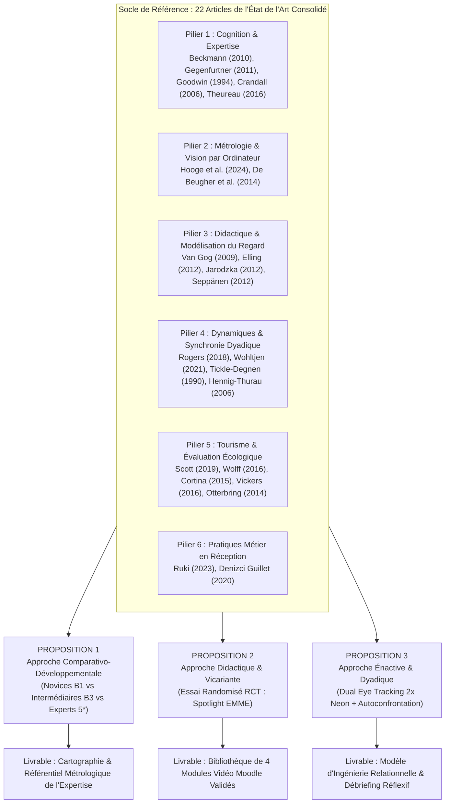
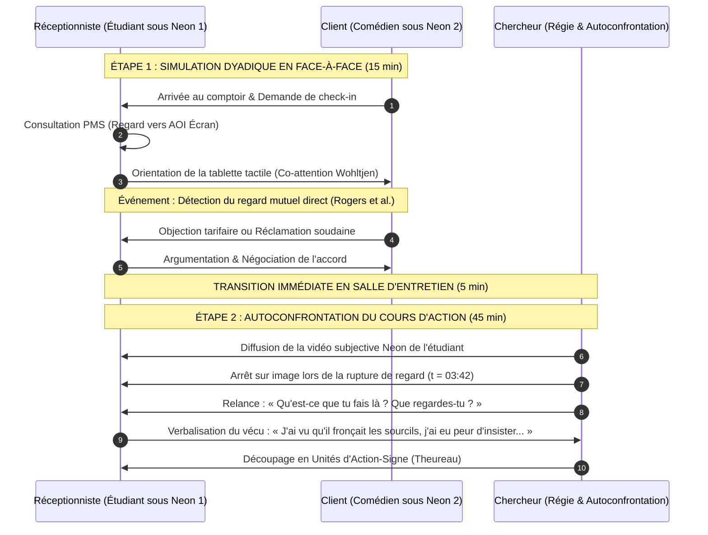

# Traité Méthodologique Exhaustif : Projet SIMACCUEIL

**Programme de Recherche Appliquée Lab-DRA (HECh / HEL)**  
**Intitulé du Programme** : *SIMACCUEIL — Oculométrie Mobile (Pupil Labs Neon), Cognition Située & Pratiques d'Accueil Hôtelier (Upselling & Gestion de Réclamations)*  
**Chercheur Principal** : Jérôme Foguenne  
**Institutions de Rattachement** : Haute École Charlemagne (HECh) & Haute École de Liège (HEL)  
**Date d'Actualisation** : Octobre 2026  

---

## 1. Cadre Général, Épistémologie & Glossaire Vulgarisé

### 1.1. Problématique Centrale du Projet SIMACCUEIL
Dans le secteur de l'hospitalité et de la gestion hôtelière haut de gamme, le comptoir de réception (*front desk*) constitue le point névralgique de la relation client. Le réceptionniste y est soumis à une injonction paradoxale permanente :
1. **D'un côté, une exigence relationnelle et émotionnelle maximale** : accueillir chaleureusement le voyageur, pratiquer une écoute active bienveillante, désamorcer les tensions lors d'un incident de séjour et argumenter avec subtilité des prestations complémentaires payantes (*upselling*).
2. **De l'autre, une contrainte technique et procédurale lourde** : manipuler un progiciel de gestion hôtelière (*Property Management System* - PMS) dense, vérifier les disponibilités de chambres, contrôler les statuts de facturation, saisir les pièces d'identité et piloter des supports visuels annexes (tablette tactile commerciale).

Comment un être humain parvient-il — ou échoue-t-il — à coordonner son attention visuelle, sa réflexion cognitive et sa parole entre ces deux pôles en tension ? Comment l'expertise transforme-t-elle cette compétence ? Et comment les Hautes Écoles peuvent-elles former efficacement les futurs professionnels à cette « gymnastique attentionnelle » ?

Pour répondre à ces questions, le projet **SIMACCUEIL** déploie un dispositif scientifique novateur fondé sur l'**oculométrie mobile de dernière génération** (*Pupil Labs Neon*). Ce document formalise **trois propositions méthodologiques exhaustives, complètes et autonomes**, prêtes pour le dépôt auprès des organismes de financement de la recherche appliquée et pour la mise en œuvre pratique au laboratoire.

---

### 1.2. Glossaire Méthodologique Vulgarisé
Afin de concilier la plus stricte rigueur académique et une accessibilité pédagogique totale, les concepts scientifiques mobilisés dans ce traité sont définis et vulgarisés comme suit :

* **Oculométrie Mobile (*Wearable Eye Tracking*)** : Mesure continue du regard via des lunettes légères équipées de micro-caméras infrarouges filmant les yeux (à 200 images par seconde) et d'une caméra haute définition filmant la scène vue par le participant. Contrairement aux eye trackers fixes de bureau qui imposent de rester assis immobile devant un écran d'ordinateur, les lunettes *Pupil Labs Neon* permettent au réceptionniste de bouger naturellement la tête, de manipuler des objets réels (clés, cartes, tablette) et d'échanger en face-à-face avec un client en chair et en os.
* **Fixation & Saccade** :
  * Une **fixation** est un arrêt stable du regard sur un point précis durant au moins 100 millisecondes. C'est uniquement pendant ces arrêts que le cerveau prélève de l'information visuelle nette (via la fovéa, zone centrale de la rétine) et la traite cognitivement.
  * Une **saccade** est le saut ultra-rapide (20 à 40 millisecondes) que fait l'œil pour changer de cible. Durant la saccade, le cerveau désactive temporairement la perception visuelle (*suppression saccadique*) pour éviter un flou de mouvement permanent.
* **Zones d'Intérêt (AOI - *Areas of Interest*)** : Régions virtuelles délimitées par le chercheur dans l'environnement pour comptabiliser automatiquement les métriques du regard.
  * *AOI Statique* : Délimitée sur une surface fixe (ex. : l'écran du logiciel PMS sur le comptoir, ou la case précise affichant le tarif d'une chambre).
  * *AOI Dynamique* : Délimitée sur un élément en mouvement dans l'espace tridimensionnel (ex. : les yeux ou la bouche du client qui parle, les mains qui gesticulent, ou la tablette tactile manipulée en cours d'échange).
* **Charge Cognitive (Théorie de la CLT - *Cognitive Load Theory*)** : Quantité d'effort mental instantané requis par la mémoire de travail (qui a une capacité limitée à environ 4 ou 5 éléments simultanés).
  * *Charge intrinsèque* : Liée à la difficulté naturelle de la tâche (ex. : calculer mentalement la différence tarifaire entre deux catégories de suites).
  * *Charge extrinsèque* : Effort parasite causé par un outil mal conçu ou mal maîtrisé (ex. : perdre du temps à chercher où se trouve le bouton de validation sur une interface logicielle hostile).
  * *Charge utile (*germane*)* : Effort mental consacré à la compréhension, à la réflexion stratégique et à la mémorisation durable.
* **PMS (*Property Management System*)** : Le progiciel central utilisé dans l'hôtellerie (ex. : Opera, Fidelio, Mews, Protel) regroupant l'ensemble des données d'exploitation : planning des chambres, fiches signalétiques des clients, historique des consommations, facturation et assignation des clés.
* **Upselling Multicanal** : Démarche commerciale visant à inciter un client à choisir une chambre plus spacieuse, mieux équipée ou offrant une vue supérieure à celle initialement réservée, moyennant un supplément de prix. On parle d'upselling *multicanal* lorsqu'il combine des sollicitations préalables reçues par le voyageur sur internet (e-mails automatisés pré-séjour) et une concrétisation personnalisée au comptoir par le réceptionniste.
* **EMME (*Eye-Movement Modelling Examples*)** : Dispositif pédagogique d'apprentissage vicariant (par observation) où l'apprenant regarde une vidéo montrant un expert en action, avec l'incrustation visuelle directe du cheminement de son regard.
* **Effet Spotlight** : Technique visuelle appliquée à une vidéo EMME où la zone regardée par l'expert est maintenue en pleine clarté et netteté, tandis que le reste de la scène périphérique est doucement assombri ou flouté, guidant ainsi naturellement les yeux de l'étudiant sans créer de distraction parasite.
* **Cours d'Action & Autoconfrontation** : Courant de l'ergonomie cognitive francophone postulant que l'activité humaine ne peut être comprise sans recueillir le point de vue intérieur de l'acteur sur ce qu'il vit. L'*entretien d'autoconfrontation* consiste à faire visionner au participant l'enregistrement de sa propre activité sous eye tracking immédiatement après l'action, en lui demandant de commenter ce qu'il pensait, ressentait, craignait et décidait seconde par seconde.

---



---

## 2. PROPOSITION 1 : Approche Comparativo-Développementale (Novices vs Intermédiaires vs Experts)

> **Titre Académique Officiel** : *« La Vision Professionnelle en Action : Étude comparative transversale de l'allocation attentionnelle, de la charge cognitive et de la performance relationnelle en accueil hôtelier instrumenté »*  
> **Intitulé Vulgarisé** : *« Observer pour comprendre : Qu'est-ce qui différencie le regard d'un réceptionniste débutant de celui d'un professionnel chevronné face à un client ? »*

---

### 2.1. Justification Théorique Approfondie & Ancrage dans l'État de l'Art

Cette première méthodologie s'inscrit au croisement de la **psychologie cognitive de l'expertise**, de l'**ergonomie cognitive** et de l'**anthropologie des pratiques professionnelles**. Elle repose sur cinq fondements théoriques majeurs issus de l'état de l'art consolidé :

1. **Les lois universelles de l'expertise visuelle (Gegenfurtner, Lehtinen & Säljö, 2011)** :  
   Dans leur méta-analyse quantitative cumulant 296 tailles d'effet à travers 73 études oculométriques, Gegenfurtner et al. démontrent que les experts présentent des régularités oculomotrices stables quel que soit le domaine :
   * Des durées moyennes de fixation plus brèves (*long-term working memory theory* d'Ericsson), traduisant un traitement plus rapide de l'information.
   * Une sélection impitoyable de l'information utile (*information reduction hypothesis* de Haider & Frensch) : l'expert concentre ses fixations sur les zones critiques et ignore les zones redondantes ou distractives.
   * Des saccades plus longues et un accès parafovéal élargi (*holistic model* de Kundel) : l'expert perçoit en périphérie et dirige immédiatement son regard vers la cible signifiante.  
   *Transposition à SIMACCUEIL* : Le réceptionniste expert ne balaye pas l'écran au hasard. Dès l'ouverture de la réservation, son regard plonge en moins d'une seconde sur la case d'alerte, tandis que l'étudiant novice perd de précieuses secondes à lire les libellés de menus inutiles.
2. **Le Cadre de Complexité et la libération de la charge mentale (Beckmann, 2010)** :  
   Jens Beckmann démontre que la charge cognitive subjective résulte de l'interaction entre les exigences objectives de la tâche, les conditions de présentation et les capacités individuelles de mémoire de travail. Chez le novice, l'utilisation d'un logiciel hôtelier complexe génère une charge extrinsèque massive qui sature son attention. L'expert, ayant automatisé les routines logicielles (comme les changements de vitesse chez un conducteur chevronné), libère des ressources cérébrales considérables. Cette disponibilité mentale retrouvée est précisément ce qui lui permet de relever la tête et de regarder le client.
3. **La Vision Professionnelle comme pratique sociale située (Goodwin, 1994 ; Wolff et al., 2016)** :  
   Charles Goodwin a établi que regarder une scène professionnelle s'apprend au sein d'une communauté de pratique à travers des schémas de codage (*coding schemes*) et la mise en relief d'indices (*highlighting*). Wolff et al. (2016) démontrent en milieu éducatif que les enseignants experts possèdent une vision panoramique et distribuée qui leur permet d'anticiper les incidents, alors que les novices restent fixés sur un seul élève. En réception hôtelière, l'expert surveille simultanément son écran, les réactions subtiles du voyageur et l'ambiance du lobby.
4. **La stabilisation du regard préparatoire : Le Quiet Eye (Vickers, 2016)** :  
   Joan Vickers définit le *Quiet Eye* comme la dernière fixation stabilisée (au moins 100 ms dans un angle inférieur à 3°) sur une zone critique avant le déclenchement d'un geste ou d'un acte décisif. La durée du Quiet Eye est en moyenne 62 % plus longue chez les experts. Dans SIMACCUEIL, cette méthodologie teste l'hypothèse inédite selon laquelle le réceptionniste expert stabilise son regard sur l'indice clé (le tarif ou le visage du client) juste avant de verbaliser son offre d'upselling ou d'annoncer la solution à une réclamation, ce qui assure le contrôle de son débit vocal et renforce son pouvoir de persuasion.
5. **La convergence méthodologique low-inference / high-inference (Cortina et al., 2015)** :  
   Cortina et ses collègues ont apporté la preuve décisive que des mesures oculométriques directes (*low-inference data*, ex. : temps passé à regarder les visages) corrèlent très fortement avec les évaluations qualitatives globales de la qualité de service menées par des observateurs externes (*high-inference data* via le protocole CLASS). Cette référence justifie scientifiquement l'utilisation de l'eye tracking comme mesure objective de la compétence d'accueil.
6. **L'ancrage métier de l'upselling de luxe (Ruki, 2023 ; Denizci Guillet, 2020)** :  
   Made Ruki détaille le triptyque de compétences exigé au Ritz-Carlton Bali (procédures rigoureuses, aisance linguistique en anglais et connaissance technique approfondie des produits). Denizci Guillet modélise l'articulation entre les sollicitations numériques reçues par le client et l'argumentation physique en réception. Ces deux textes fondent le réalisme métier des scénarios testés.

---

### 2.2. Dispositif Expérimental & Scénarisation Détaillée

#### Échantillonnage & Critères d'Inclusion
L'étude repose sur un plan transversal comparant trois cohortes contrastées de participants (Total N = 60) :
* **Groupe 1 : Novices (N = 20)** : Étudiants inscrits en 1re année de Bachelier en Gestion Hôtelière à l'HECh ou à l'HEL. Critères d'inclusion : avoir suivi les cours théoriques d'introduction, mais n'avoir encore réalisé aucun stage pratique en milieu professionnel hôtelier ni manipulé le PMS en conditions réelles.
* **Groupe 2 : Intermédiaires (N = 20)** : Étudiants inscrits en dernière année (Bloc 3) de Bachelier en Gestion Hôtelière. Critères d'inclusion : avoir validé l'ensemble de leurs stages pratiques de réception (minimum 12 semaines en établissement hôtelier) et maîtriser les fonctions courantes du PMS.
* **Groupe 3 : Experts Professionnels (N = 20)** : Réceptionnistes, premiers de réception ou chefs de réception en exercice dans des établissements hôteliers 4 étoiles supérieur ou 5 étoiles en Belgique ou dans l'Euregio. Critères d'inclusion : justifier d'au moins 3 ans d'ancienneté continue au front desk et utiliser quotidiennement un progiciel hôtelier professionnel.

#### Aménagement Scénographique du Laboratoire SIMACCUEIL
L'expérimentation se déroule dans une salle dédiée aménagée pour reproduire fidèlement un comptoir de réception d'hôtel 4 étoiles :
* **Le Comptoir Professionnel** : Meuble d'accueil de hauteur standard (115 cm côté client, 90 cm côté réceptionniste).
* **L'Écran du PMS (Ordinateur fixe)** : Écran 24 pouces orienté à 45° sur le côté gauche du réceptionniste pour ne pas faire obstacle au contact visuel direct avec le voyageur. Le logiciel simulé reproduit l'ergonomie des leaders du marché (champs de recherche, état des chambres par code couleur, historique des requêtes).
* **La Tablette Client Tactile** : Tablette iPad Pro 12,9 pouces posée sur un support rotatif au centre du comptoir, manipulable par le réceptionniste pour présenter des visuels immersifs des suites hôtelières.
* **L'Équipement d'Oculométrie Mobile** : Une paire de lunettes légères **Pupil Labs Neon** (poids : 39 grammes, capture binoculaire à 200 Hz, caméra de scène frontale 1080p grand-angle à 30 images par seconde avec capteur inertiel IMU intégré).
* **Le Dispositif Audiovisuel Complémentaire** : Deux microphones-cravates sans fil synchronisés (un sur le réceptionniste, un sur le client) et deux caméras d'ambiance 4K filmant la scène de profil et de face pour l'encodage des postures corporelles et des expressions du visage.

---

#### Scénarios Standardisés Déroulés Pas à Pas

##### Scénario 1 : L'Upselling Multicanal Préparé (Durée : 7 minutes)
* **Contexte pour le participant** : Vous êtes réceptionniste à l'Hôtel Continental Liège (4* sup). Il est 15h30. Un client individuel se présente pour son enregistrement (*check-in*). Il a réservé une Chambre Confort pour 2 nuits au tarif de 140 €/nuit.
* **Informations dissimulées dans le PMS** : Lorsque le participant ouvre la fiche de réservation (dossier client au nom de M. Jean Dumont), une icône spécifique indique que lors de sa réservation en ligne, le client s'est attardé 4 minutes sur la page de la *Suite Exécutive avec Terrasse Panoramique* et a ouvert l'e-mail promotionnel pré-séjour sans concrétiser l'achat. Le PMS indique que la Suite Exécutive est libre et nettoyée pour ses dates. Le tarif standard de la suite est de 260 €/nuit, mais la direction autorise une offre d'upselling exceptionnelle à **60 € de supplément par nuit** (soit 200 €/nuit au lieu de 260 €).
* **Script du comédien (le client standardisé)** : Le client est courtois mais pressé par une journée de voyage. Il dépose sa carte d'identité sur le comptoir en disant : *« Bonjour, j'ai une réservation au nom de Dumont pour deux nuits. »* Si le réceptionniste n'aborde pas spontanément la chambre, le client demande simplement si la chambre dispose d'un espace de travail calme. Si le réceptionniste propose le surclassement sans support visuel, le client hésite : *« 60 euros de plus ? Je ne sais pas si ça vaut vraiment la peine pour travailler... »* Si le réceptionniste pivote la tablette et montre les photos de la terrasse et du salon séparé tout en argumentant le calme et la machine Nespresso, le comédien applique une règle stricte : il accepte l'offre si l'argumentation a duré moins de 45 secondes et a maintenu un contact visuel soutenu.

##### Scénario 2 : La Réclamation Complexe sur Chambre Indisponible (Durée : 7 minutes)
* **Contexte pour le participant** : Il est 16h00. Un client fidèle (statut VIP Silver) arrive à la réception.
* **Informations dissimulées dans le PMS** : Le client (M. Pierre Lambert) a réservé une Chambre Privilège Grand Lit. Cependant, le PMS affiche une alerte rouge bloquante : la gouvernante générale signale une fuite d'eau dans la salle de bain de cette chambre, qui a été mise hors service (*out of order*) il y a 20 minutes. Aucune autre Chambre Privilège n'est disponible immédiatement. Il reste uniquement :
  * Soit une Chambre Standard (catégorie inférieure), prête immédiatement.
  * Soit une Junior Suite (catégorie très supérieure), mais qui ne sera prête que dans 45 minutes après un contrôle final du service des étages.
* **Script du comédien (le client standardisé)** : Le client arrive visiblement fatigué et tendu. Il déclare d'emblée : *« Bonjour. J'espère que ma chambre est prête, j'ai une visioconférence cruciale dans 20 minutes et j'ai absolument besoin de m'installer et de me rafraîchir. »* Lorsque le réceptionniste consulte son écran et découvre le problème, le comédien observe son attitude :
  * Si le réceptionniste s'enferme dans son écran pendant plus de 15 secondes sans parler, le client s'agace : *« Il y a un souci ? Je vous ai dit que je suis très pressé ! »*
  * Le comédien teste l'empathie et la capacité d'arbitrage : il exige une solution immédiate. Le bon comportement attendu consiste à lever immédiatement les yeux vers lui, exprimer des regrets sincères sans accuser les collègues des étages, lui offrir un accès immédiat au salon exécutif avec boisson et connexion haut débit pour sa conférence, tout en lui accordant le surclassement offert dans la Junior Suite dès la fin de sa réunion.

---

### 2.3. Plan du Projet de Recherche (Phasage Détaillé sur 12 Mois)

```
[Mois 01-02] : Cadrage ergonomique, conception technique PMS & étude pilote (N=4)
[Mois 03-05] : Passation expérimentale des 60 participants (Novices, Intermédiaires, Experts)
[Mois 06-07] : Traitement algorithmique par vision par ordinateur & double codage qualité
[Mois 08-09] : Analyses statistiques comparatives (ANOVA, MANOVA, Régressions logistiques)
[Mois 10-12] : Rédaction du rapport de recherche Lab-DRA & Référentiel de compétences HECh
```

#### Déroulement Chronologique d'une Session Individuelle (45 minutes par sujet)
Chaque participant est accueilli individuellement dans le laboratoire selon un protocole chronométré :
* **$T_0$ à $T_{10}$ (10 minutes) : Accueil, information éthique et équipement**  
  Signature du formulaire de consentement conforme au RGPD. Installation des lunettes *Pupil Labs Neon*. Vérification de la calibration automatique du regard via la mire de contrôle sur tablette.
* **$T_{10}$ à $T_{15}$ (5 minutes) : Immersion et prise en main de l'environnement**  
  Le participant découvre le comptoir, prend en main la souris du PMS virtuel et manipule le support de la tablette. Lecture de la fiche de mission générale de l'hôtel.
* **$T_{15}$ à $T_{22}$ (7 minutes) : Exécution du Scénario 1 (Upselling multicanal)**  
  Entrée du client comédien 1. Déroulement de l'interaction commerciale. Enregistrement continu de l'oculométrie, de l'audio et des actions logicielles.
* **$T_{22}$ à $T_{25}$ (3 minutes) : Transition et pause cognitive**  
  Sortie du premier comédien. Le participant remplit une brève échelle d'auto-évaluation de son stress ressenti.
* **$T_{25}$ à $T_{32}$ (7 minutes) : Exécution du Scénario 2 (Réclamation critique)**  
  Entrée du comédien 2. Déroulement de l'interaction de gestion de crise. Enregistrement des données.
* **$T_{32}$ à $T_{40}$ (8 minutes) : Mesure de la charge mentale subjective**  
  Passation du questionnaire psychométrique d'effort mental basé sur le *Complexity Framework* de **Beckmann (2010)** et l'échelle NASA-TLX (exigences mentales, exigences temporelles, frustration, performance perçue).
* **$T_{40}$ à $T_{45}$ (5 minutes) : Retrait du matériel et clôture**  
  Déséquipement, débriefing informel de bienveillance et remise de la compensation forfaitaire de participation.

---

### 2.4. Objectifs Stratégiques et Opérationnels de la Proposition 1

* **Objectif Opérationnel 1.1** : Quantifier avec exactitude le différentiel d'allocation attentionnelle entre l'outil informatique et le voyageur.  
  *Cible mesurable* : Démontrer que le ratio de temps passé à regarder le client par rapport à l'écran PMS est supérieur à $1.2$ chez les professionnels experts, alors qu'il est inférieur à $0.4$ chez les novices B1.
* **Objectif Opérationnel 1.2** : Mesurer la vitesse d'extraction de l'information décisionnelle sur le progiciel hôtelier.  
  *Cible mesurable* : Attester que le délai jusqu'à la première fixation utile (*Time to First Fixation*) sur l'indice commercial d'upselling est inférieur à 1 500 ms chez les experts, contre plus de 5 500 ms chez les novices.
* **Objectif Opérationnel 1.3** : Valider empiriquement le rôle régulateur du *Quiet Eye* dans l'accueil de service.  
  *Cible mesurable* : Démontrer qu'une durée de Quiet Eye stable supérieure à 300 ms avant la prise de parole critique est prédictive d'un taux de succès d'upselling deux fois supérieur (Odd Ratio $\ge 2.0$).
* **Objectif Opérationnel 1.4** : Établir la grille d'évaluation diagnostique de la compétence d'accueil pour la Haute École Charlemagne et la Haute École de Liège.

---

### 2.5. Grille Exhaustive des Indicateurs Opérationnels (Proposition 1)

| Famille d'Indicateurs | Nom de l'Indicateur | Définition Mathématique & Unité | Protocole de Mesure | Signification pour le Métier | Référence Clé SOTA |
| :--- | :--- | :--- | :--- | :--- | :--- |
| **Captation Informatique** | **Dwell Time PMS (%)** | $\frac{\sum \text{Durées fixations AOI PMS}}{\text{Durée totale simulation}} \times 100$ (%) | Surface tracking automatique sous Pupil Cloud | Révèle la dépendance et l'enfermement du regard dans l'ordinateur. | **Beckmann (2010)** (Charge extrinsèque) |
| **Sélectivité Visuelle** | **Fixation Rate PMS** | $\frac{\text{Nombre total de fixations sur PMS}}{\text{Minute d'enregistrement}}$ (fixations/min) | Algorithme I-DT de détection de fixations | Un taux élevé traduit un regard saccadé et anxieux cherchant désespérément l'info. | **Gegenfurtner et al. (2011)** (Information reduction) |
| **Vitesse d'Accès** | **Time to First Fixation (TTFF) Tarif** | Horodatage première fixation sur AOI Tarif moins Horodatage ouverture dossier (ms) | Synchronisation logs PMS & horloge Neon | Vitesse d'accès direct guidée par l'empan parafovéal de l'expert. | **Gegenfurtner et al. (2011)** (Modèle holistique) |
| **Présence Relationnelle** | **Gaze Ratio Client / PMS** | $\frac{\text{Dwell Time total Visage Client}}{\text{Dwell Time total Écran PMS}}$ (ratio sans unité) | Calcul automatisé sur coordonnées de regard | Marqueur central de la disponibilité relationnelle accordée au voyageur. | **Wolff et al. (2016)** (Vision distribuée) |
| **Préparation Décisionnelle** | **Quiet Eye Duration (QED)** | Durée (ms) de la dernière fixation stable ($\ge 100\text{ ms}$, dispersion $\le 3^\circ$) précédant la parole critique | Analyse conjointe tracé oculaire et onde audio micro | Stabilisation cognitive et contrôle émotionnel avant l'argumentation de vente. | **Vickers (2016)** (Quiet Eye) |
| **Qualité Expressive** | **Duchenne Smile Frequency** | Nombre de sourires authentiques (contraction conjointe zygomatiques et orbiculaires) | Codage vidéo FACS de face par observateur certifié | Sincérité de l'accueil opposée au simple masque commercial forcé (*surface acting*). | **Hennig-Thurau et al. (2006)** (Sourires authentiques) |
| **Coordination Non Verbale** | **Score de Rapport Interpersonnel** | Note de 1 à 7 sur les 3 dimensions : attention mutuelle, positivité, coordination | Évaluation par 2 experts indépendants en aveugle | Qualité de l'alliance relationnelle établie avec le client. | **Tickle-Degnen & Rosenthal (1990)** & **Cortina (2015)** |
| **Efficacité Commerciale** | **Upselling Success Rate** | Variable binaire : 1 si surclassement acheté à 60 €/nuit, 0 si refusé | Log de clôture du scénario PMS | Rentabilité financière brute générée par l'action du réceptionniste. | **Denizci Guillet (2020)** & **Ruki (2023)** |
| **Gestion d'Incident** | **Score de Désescalade Réclamation** | Échelle de 1 à 5 mesurant l'apaisement perçu, la réactivité et la pertinence de l'offre | Questionnaire post-scénario rempli par le comédien | Capacité à préserver la fidélité client lors d'une défaillance de service. | Référentiel de service hôtelier haut de gamme |

---

### 2.6. Traitement des Données & Validation Scientifique

* **Pipeline Informatique Automatisé (De Beugher, Brône & Goedemé, 2014)** :  
  Pour traiter les 120 flux vidéo HD issus des passations sans mobiliser des mois d'encadrement manuel, un script Python exploitant le modèle *YOLOv8* entraîné sur l'environnement du laboratoire détecte automatiquement dans chaque trame la boîte englobante de l'écran du PMS, de la tablette et du visage du client. Les coordonnées de regard (gaze coordinates) sont projetées sur ces masques pour extraire instantanément les indicateurs temporels.
* **Analyses Statistiques Inférentielles** :
  * *Comparaisons inter-groupes* : Des analyses de variance univariées et multivariées (ANOVA / MANOVA à 3 niveaux : Novices, Intermédiaires, Experts) testeront les différences significatives sur le *Dwell Time*, le *TTFF* et le *Quiet Eye*, assorties de tests post-hoc de Tukey et du calcul des tailles d'effet (d de Cohen et $\eta^2$ partiel).
  * *Modélisation prédictive* : Une régression logistique binaire hiérarchique déterminera le poids respectif de la durée de fixation sur le client, du Quiet Eye et de l'ancienneté professionnelle dans la prédiction de la réussite commerciale de l'upselling.

---

## 3. PROPOSITION 2 : Approche Didactique & Vicariante (Interventionnelle par EMME)

> **Titre Académique Officiel** : *« Ingénierie Pédagogique par Modélisation du Regard (EMME) : Évaluation de l'impact d'un guidage attentionnel "Spotlight" sur l'apprentissage des compétences d'accueil hôtelier »*  
> **Intitulé Vulgarisé** : *« Apprendre à travers les yeux d'un expert : Des capsules vidéo montrant le regard d'un professionnel permettent-elles aux étudiants de mieux réussir l'accueil ? »*

---

### 3.1. Justification Théorique Approfondie & Ancrage dans l'État de l'Art

Cette deuxième méthodologie s'inscrit au cœur des **sciences de l'éducation**, de la **technopédagogie** et de la **didactique professionnelle** :

1. **L'apprentissage par modélisation du regard expert (EMME) et l'effet Spotlight (Jarodzka et al., 2012)** :  
   Dans leur étude expérimentale princeps sur l'apprentissage du diagnostic médical, Jarodzka et ses collaborateurs démontrent que la manière de rendre visible le regard expert conditionne intégralement les résultats d'apprentissage. Un simple cercle rouge mobile se déplaçant sur l'écran attire l'attention sur lui-même comme un distracteur parasite et empêche l'étudiant d'analyser la scène globale. En revanche, la technique du **Spotlight** (conserver la zone fixée nette et lumineuse tout en estompant doucement l'arrière-plan dans un voile flou) guide l'attention de manière naturelle et intuitive. Les étudiants formés avec le *Spotlight* surclassent significativement les étudiants formés par cours magistral ou par cercle lors d'évaluations ultérieures autonomes sans guidage visuel.
2. **Accélération de la maîtrise procédurale (Seppänen & Gegenfurtner, 2012)** :  
   Seppänen et Gegenfurtner prouvent qu'observer une tâche complexe à travers les yeux de l'enseignant accélère l'adoption d'un balayage méthodique chez les étudiants et prévient la fixation prématurée sur des éléments non pertinents. Dans l'apprentissage du front desk hôtelier, modéliser le regard d'un réceptionniste chevronné permet d'enseigner explicitement comment basculer son regard entre le client et l'écran de façon économique.
3. **Prévention absolue de la redondance cognitive (Van Gog, Paas, Marcus, Ayres & Sweller, 2009)** :  
   Tamara van Gog et John Sweller ont démontré qu'une modélisation visuelle mal pensée peut se révéler contre-productive si elle entre en compétition avec des explications auditives trop denses (*split-attention effect* et *redundancy effect*). Si l'étudiant doit à la fois regarder le tracé des yeux, écouter un long discours et lire des textes, sa mémoire de travail sature. Cette découverte impose de concevoir des capsules EMME extrêmement courtes (moins de 3 minutes), avec une bande audio sobre et épurée, n'explicitant que le *pourquoi* de l'action.
4. **L'analyse des silences comme révélateur de la charge mentale (Elling, Lentz & de Jong, 2012)** :  
   Sanne Elling et ses collègues démontrent que les périodes de silence (qui représentent environ 27 % du temps d'une tâche instrumentée) sont les moments où l'utilisateur subit une saturation cognitive ou un blocage technique. Dans le protocole expérimental de SIMACCUEIL, mesurer la diminution des silences prolongés face au client entre le pré-test et le post-test fournira la preuve objective que la formation a libéré l'esprit de l'étudiant.
5. **Rigueur de conception des zones d'intérêt (Hooge et al., 2024)** :  
   Hooge et al. formalisent les exigences de calibrage des AOI pour s'assurer que les progrès enregistrés ne soient pas des artefacts de mesure, notamment en tenant compte de la résolution angulaire du matériel.

---

### 3.2. Dispositif Expérimental & Essai Contrôlé Randomisé (RCT)

#### Population & Procédure de Randomisation
L'expérimentation implique **50 étudiants** de 2e année de Bachelier en Gestion Hôtelière à l'HECh/HEL.
* **Stratification préalable** : Les étudiants sont stratifiés selon leur niveau d'aisance informatique déclaré et leurs notes au cours de techniques d'accueil du semestre précédent.
* **Tirage au sort aléatoire (Randomisation 1:1)** :
  * **Groupe Expérimental EMME Spotlight ($N = 25$)** : Bénéficie de la formation standard enrichie de 4 capsules vidéo interactives conçues selon la technique du *Spotlight* oculaire.
  * **Groupe Contrôle Conventionnel ($N = 25$)** : Bénéficie de la formation standard sur les mêmes cas cliniques, avec les mêmes vidéos mais *sans l'effet de regard Spotlight*, accompagnées de fiches textuelles et d'explications professorales classiques.

---

#### Conception Numérique des 4 Capsules « Spotlight »
Quatre modules d'apprentissage multimédia de 2 minutes 30 chacun sont produits au laboratoire :
* **Module 1 (Upselling - Détection de l'indice PMS)** : Modélisation du regard d'un expert ouvrant une réservation. Le *Spotlight* montre comment le regard cible immédiatement le champ historique client (200 ms), puis bascule vers le tarif de surclassement, évitant de lire les champs d'adresse ou de facturation sans rapport.
* **Module 2 (Upselling - Présentation de l'offre sur tablette)** : Le *Spotlight* montre comment l'expert pivote la tablette vers le client tout en synchronisant son regard : il regarde la photo de la terrasse en même temps que le client, puis relève immédiatement les yeux vers le visage du client dès qu'il énonce le tarif préférentiel.
* **Module 3 (Réclamation - Écoute active et fuite oculaire évitée)** : Modélisation d'une situation de litige. La capsule montre comment l'expert maintient ses yeux fixés sur le visage du voyageur mécontent pendant les 30 premières secondes de l'explication, résistant à la tentation de se réfugier immédiatement les yeux baissés sur son clavier.
* **Module 4 (Réclamation - Saisie rapide et compensation)** : Le *Spotlight* guide l'étudiant pour vérifier le statut des chambres libres en moins de 5 secondes, avant de réancrer son regard sur le client pour formuler la solution d'apaisement.

---

### 3.3. Plan du Projet de Recherche (Phasage Détaillé sur 10 Mois)

```
[Mois 01-03] : Production algorithmique des 4 capsules Spotlight (FFmpeg/Python)
[Mois 04]    : Passation du Pré-test T0 sous lunettes Neon (50 étudiants)
[Mois 05]    : Phase d'intervention didactique (Bras Expérimental vs Bras Contrôle)
[Mois 06]    : Passation du Post-test T1 sous lunettes Neon (Cas inédit)
[Mois 07-08] : Traitement des gains d'apprentissage Delta(T1 - T0) & Analyse des silences
[Mois 09-10] : Intégration sur Moodle HECh/HEL & Dissémination pédagogique
```

#### Déroulement Temporel de l'Expérimentation Didactique
1. **Étape Pré-test $T_0$ (Semaine 1, Mois 4)** :  
   Les 50 étudiants passent individuellement une mise en situation d'accueil de 6 minutes au comptoir SIMACCUEIL, équipés des lunettes *Pupil Labs Neon*. Le scénario implique une tentative d'upselling standard. Enregistrement de la ligne de base comportementale et oculométrique de chaque sujet.
2. **Étape d'Intervention Pédagogique (Semaines 2 à 4, Mois 5)** :  
   Pendant 3 semaines, les étudiants travaillent en semi-autonomie dans le cadre de leurs travaux pratiques :
   * Le *Groupe Expérimental* visionne les capsules EMME Spotlight via une interface interactive développée sous Moodle, intégrant des temps d'arrêt sur image pour observer les zones fovéales expertes.
   * Le *Groupe Contrôle* travaille sur les mêmes études de cas à partir de supports vidéo conventionnels et de fiches mémo récapitulatives.
   * Le temps d'exposition à la formation est rigoureusement égalisé entre les deux groupes (exactement 45 minutes de travail hebdomadaire).
3. **Étape Post-test $T_1$ (Semaine 5, Mois 6)** :  
   Chaque étudiant repasse une nouvelle mise en situation d'accueil sous lunettes Neon face à un comédien. Le scénario est rigoureusement équivalent en structure mais porte sur une typologie de chambre et une identité de client différentes pour neutraliser tout effet de simple répétition mécanique.
4. **Étape d'Évaluation de la Rétention $T_2$ (Optionnelle à 2 mois)** :  
   Un sous-échantillon de 20 étudiants repasse un test différé lors des examens pratiques de fin de quadrimestre pour vérifier la persistance à long terme des schémas visuels acquis.

---

### 3.4. Objectifs Stratégiques et Opérationnels de la Proposition 2

* **Objectif Didactique 2.1** : Démontrer une amélioration significative de l'orientation du regard vers le client.  
  *Cible mesurable* : Le groupe expérimental EMME Spotlight devra afficher une progression moyenne du temps de regard dirigé vers le client ($\Delta T_1 - T_0$) d'au moins $+35\%$, contre moins de $+10\%$ pour le groupe contrôle.
* **Objectif Didactique 2.2** : Réduire le temps d'errance et d'hésitation sur l'interface du PMS.  
  *Cible mesurable* : Diminution de la durée moyenne des fixations consacrées aux menus non pertinents du PMS d'au moins $40\%$ dans le groupe expérimental.
* **Objectif Didactique 2.3** : Réduire les silences de panique face au voyageur.  
  *Cible mesurable* : Division par deux de la durée cumulée des silences supérieurs à 2 secondes pendant lesquels l'étudiant a les yeux bloqués sur l'écran d'ordinateur.
* **Objectif Pédagogique 2.4** : Produire une suite de 4 modules de formation multimédia transférables et pérennes pour le bachelier en management hôtelier de l'HECh et de l'HEL.

---

### 3.5. Grille Exhaustive des Indicateurs Opérationnels (Proposition 2)

| Dimension Évaluée | Nom de l'Indicateur | Formule de Calcul & Unité | Outil de Collecte | Ce que l'Indicateur Démontre | Référence Clé SOTA |
| :--- | :--- | :--- | :--- | :--- | :--- |
| **Gain Attentionnel Client** | **$\Delta \text{Gaze Client}$** | $\% \text{Temps Client}(T_1) - \% \text{Temps Client}(T_0)$ (points %) | Pupil Labs Neon (AOI Visage Client) | Mesure le transfert effectif du regard de l'écran vers le visage de l'interlocuteur. | **Jarodzka et al. (2012)** (Guidage Spotlight) |
| **Optimisation Logicielle** | **$\Delta \text{Errance PMS}$** | $\text{Dwell Time PMS}(T_0) - \text{Dwell Time PMS}(T_1)$ (secondes) | Surface tracking sur l'écran PMS | Démontre l'assimilation du parcours visuel direct sans recherche aléatoire. | **Seppänen & Gegenfurtner (2012)** (Modélisation) |
| **Fluidité Verbale** | **Indice de Silence Bloquant** | Durée totale des pauses orales $> 2\text{ s}$ avec regard figé sur le PMS (s) | Détection conjointe flux audio et coordonnées de regard | Atteste de la disparition des épisodes de panique ou de surcharge cognitive face au client. | **Elling, Lentz & de Jong (2012)** (Silences) |
| **Charge Mentale Ressentie** | **Score d'Effort Mental Paas** | Note sur l'échelle psychométrique standardisée de Paas (1 à 9) | Questionnaire auto-administré post-simulation | Confirme que le guidage a allégé la charge extrinsèque sans fatiguer l'apprenant. | **Van Gog et al. (2009)** & **Beckmann (2010)** |
| **Conformité de l'Ordre** | **Séquence Visuelle Experte** | Indice binaire (1 = séquence respectée : Profil $\rightarrow$ Tarif $\rightarrow$ Tablette $\rightarrow$ Client) | Analyse de séquences de transition d'AOI | Valide que le schéma de raisonnement professionnel expert a été intériorisé. | **Van Gog et al. (2009)** (Exemples résolus) |
| **Performance Commerciale** | **Qualité de l'Offre Upselling** | Score sur 20 points évalué par grille critériée (clarté tarifaire, argumentation bénéfices) | Évaluation professorale indépendante | Mesure la traduction de l'aisance visuelle en performance commerciale réelle. | **Ruki (2023)** & **Denizci Guillet (2020)** |
| **Apaisement de Plainte** | **Maintien du Contact Oculaire** | Durée cumulée de regard sur le client pendant l'exposé initial du grief (s) | AOI Visage sous Neon | Démontre la capacité de l'étudiant à manifester une écoute active sans fuite visuelle. | **Tickle-Degnen & Rosenthal (1990)** (Attention) |

---

### 3.6. Traitement des Données & Analyse des Gains d'Apprentissage

* **Modélisation Linéaire Mixte (LMM - *Linear Mixed Models*)** :  
  Pour tenir compte des mesures répétées sur les mêmes sujets entre le pré-test et le post-test, des modèles linéaires mixtes testeront l'interaction $Groupe \times Temps$ ($Bras \; [Expérimental/Contrôle] \times Temps \; [T_0, T_1]$). Un effet d'interaction statistiquement significatif ($p < 0.05$) apportera la preuve scientifique irréfutable que la progression est imputable au dispositif EMME Spotlight et non à la simple maturation des étudiants.
* **Calcul des Tailles d'Effet Pédagogiques** :  
  Calcul du $d$ de Cohen pour mesurer l'impact pratique de l'innovation technopédagogique ($d \ge 0.80$ exigé pour conclure à un effet pédagogique majeur).

---

## 4. PROPOSITION 3 : Approche Énactive & Interactionnelle Dyadique (Dual Eye Tracking & Cours d'Action)

> **Titre Académique Officiel** : *« Énaction et Synchronie Sociale : Analyse dyadique de l'interaction d'accueil hôtelier par double oculométrie mobile synchronisée et entretiens d'autoconfrontation du cours d'action »*  
> **Intitulé Vulgarisé** : *« Se regarder, se comprendre, s'écouter : Que se passe-t-il vraiment dans les yeux et dans la tête du réceptionniste et du client pendant qu'ils se parlent ? »*

---

### 4.1. Justification Théorique Approfondie & Ancrage dans l'État de l'Art

Cette troisième proposition représente l'**état de l'art mondial en matière de recherche sur les interactions de service**, en rompant définitivement avec l'observation unilatérale d'un individu isolé pour saisir la relation comme un système dynamique couplé :

1. **La réalité du regard social face-à-face : Le Dual Eye Tracking (Rogers, Speelman, Guidetti & Longmuir, 2018)** :  
   Dans leur publication majeure parue dans *Scientific Reports*, Shane Rogers et ses collègues brisent un mythe tenace de la communication professionnelle : les êtres humains en conversation face-à-face ne se regardent presque jamais dans les yeux en continu ! Le contact oculaire direct mutuel (*eye contact*) est un événement rare et fugace qui ne représente qu'une infime proportion du temps total. Lorsque nous devons réfléchir, formuler une phrase complexe ou traiter une information difficile, nous détournons spontanément notre regard vers un point neutre (*gaze aversion*) afin de réduire notre charge cognitive. Par conséquent, il est parfaitement sain et normal qu'un réceptionniste détourne ses yeux de son client pour calculer un tarif ou lire son écran ; toute la question scientifique est d'identifier **à quel moment exact** ce détournement s'opère et à quel moment le contact visuel doit impérativement être restauré.
2. **Le tempo respiratoire de l'attention partagée (Wohltjen & Wheatley, 2021)** :  
   Dans une étude de référence publiée dans les *PNAS*, Sophie Wohltjen et Thalia Wheatley démontrent que le contact visuel entre deux interlocuteurs marque l'apogée (le point culminant) de la synchronisation de leur attention. Cependant, dès que le regard mutuel se produit, il déclenche immédiatement une désynchronisation attentionnelle salutaire. Cette rupture du regard est nécessaire pour permettre à chacun des partenaires de reprendre son autonomie cognitive, de penser par lui-même et de réinjecter une information nouvelle dans le dialogue. Dans SIMACCUEIL, cette découverte démontre que le balancement entre le regard vers le client et le regard vers la tablette tactile ou l'écran PMS n'est pas un défaut de politesse, mais le moteur même de la coordination conversationnelle.
3. **Le modèle tridimensionnel du rapport interpersonnel (Tickle-Degnen & Rosenthal, 1990)** :  
   Tickle-Degnen et Rosenthal démontrent que le « rapport » (le sentiment partagé d'harmonie et de confiance mutuelle) se décompose en trois composantes non verbales interconnectées dont le poids évolue au fil du temps : l'attention mutuelle (regards dirigés, orientation du corps), la positivité (sourires, hochements) et la coordination interactionnelle (postures en miroir, fluidité des transitions). L'enregistrement simultané du réceptionniste et du client permet de quantifier pour la première fois cette coordination dans un acte d'accueil hôtelier.
4. **L'épistémologie énactive du Cours d'Action (Theureau ; recension par Marc Durand, 2016)** :  
   Jacques Theureau postule que l'activité humaine est un engendrement continuel de sens, indissociable du corps de l'acteur et de son environnement matériel. On ne peut comprendre le comportement d'un réceptionniste en se contentant de mesurer des coordonnées d'yeux depuis l'extérieur : il faut accéder à la fraction de son activité qui est « montrable, racontable et mimable ». L'entretien d'autoconfrontation avec traces vidéo sous lunettes Neon permet à l'étudiant de revivre pas à pas son expérience et de reconstruire la chaîne des « unités d'action-signe » qui guidaient ses gestes.
5. **L'explicitation des savoirs tacites par la Méthode de Décision Critique (Crandall, Klein & Hoffman, 2006)** :  
   Dans le cadre de l'Analyse Cognitive des Tâches (CTA), Crandall et al. fournissent les techniques d'entretien de relance permettant de faire émerger les micro-indices perceptifs inconscients qui ont poussé le réceptionniste à agir ou à hésiter.
6. **L'authenticité émotionnelle contre le travail de surface (Hennig-Thurau et al., 2006)** :  
   Hennig-Thurau et al. démontrent que les clients détectent instantanément les sourires de façade imposés par les règlements d'entreprise (*surface acting*) et que seule l'authenticité émotionnelle déclenche une contagion affective positive. Le dispositif dyadique mesure la synchronie entre le sourire du réceptionniste et la décrispation des traits du client.
7. **L'influence de la signalétique et de la matérialité commerciale (Otterbring et al., 2014)** :  
   Otterbring et al. prouvent in situ que les supports promotionnels statiques sont totalement ignorés par un client absorbé par son but d'achat. Cela justifie la scénographie de la tablette tactile activement orientée par le réceptionniste.

---

### 4.2. Dispositif Expérimental Dyadique & Scénographie de Haute Fidélité

#### Infrastructure Réseau & Synchronisation Oculaire Absolue
Le dispositif technique repose sur le déploiement simultané de **deux paires de lunettes Pupil Labs Neon** portées en vis-à-vis :
* **Paire Neon n°1** : Portée par le réceptionniste (étudiant de Bloc 3).
* **Paire Neon n°2** : Portée par le client (comédien ou pair formé).
* **Synchronisation Réseau Local NTP (*Network Time Protocol*)** :  
  Les deux enregistreurs Neon sont connectés à un point d'accès Wi-Fi 6 dédié relié à un serveur d'horloge NTP local (*Pupil Cloud Companion Time Sync*). Ce protocole garantit une désynchronisation temporelle entre les deux flux de regard inférieure à **5 millisecondes**, permettant d'affirmer avec certitude mathématique si les deux interlocuteurs se regardent mutuellement dans les yeux à un instant $t$ précis.

---

#### Le Déroulement en Deux Étapes Inséparables : Simulation puis Autoconfrontation



1. **Étape 1 : L'Interaction Dyadique Écologique (15 minutes)** :  
   L'étudiant et le client interagissent librement au comptoir sur un scénario mixte combinant une proposition d'upselling sur tablette tactile puis l'annonce d'une défaillance de service. Les deux enregistreurs Neon capturent en continu :
   * Les deux flux de regard 200 Hz.
   * Les deux vidéos de scène subjectives HD (ce que voit le réceptionniste et ce que voit le client).
   * L'audio multicanal haute définition.
2. **Étape 2 : L'Entretien d'Autoconfrontation Immédiat (45 minutes)** :  
   Dès la fin de la simulation (dans les 10 minutes qui suivent, pour éviter toute déperdition mémorielle ou rationalisation a posteriori), l'étudiant s'installe avec le chercheur devant un écran 4K.  
   Le chercheur diffuse la vidéo enregistrée par les lunettes de l'étudiant, avec l'affichage de son point de regard et, en incrustation, du point de regard du client.  
   Conformément aux principes méthodologiques de **Jacques Theureau (2016)** et de la *Critical Decision Method* de **Crandall et al. (2006)**, le chercheur applique une posture de neutralité compréhensive et invite l'étudiant à décrire son activité au présent :
   * *« Arrêtons-nous à 2 minutes 14 : tu viens de tourner la tablette, mais tu regardes immédiatement vers le bas de ton écran PMS. Que cherches-tu à ce moment précis ? »*
   * *« À 4 minutes 30, le client dit qu'il trouve le supplément trop cher. Tes yeux fixent ses mains puis remontent vers ses yeux. Qu'as-tu perçu dans son attitude ? Quelle pensée t'a traversé l'esprit ? »*
   * *« Qu'est-ce qui t'a fait décider de lui proposer le petit-déjeuner offert plutôt que d'insister sur la superficie de la chambre ? »*

---

### 4.3. Plan du Projet de Recherche (Phasage Détaillé sur 12 Mois)

```
[Mois 01-02] : R&D Métrologique, étalonnage synchronisation NTP inter-lunettes (< 5 ms)
[Mois 03-05] : Collecte dyadique : 20 passations complètes (20 simulations + 20 autoconfrontations)
[Mois 06-08] : Traitement algorithmique CRQA de synchronie & transcription sémiotique Theureau
[Mois 09-10] : Croisement mixte des données objectives de regard et des verbalisations vécues
[Mois 11-12] : Rédaction de la monographie Lab-DRA & soumission d'article majeur (Human-Computer Interaction)
```

#### Échantillon Dyadique Ciblé
L'expérimentation repose sur **20 binômes complets** (20 étudiants de 3e année en Gestion Hôtelière face à 5 clients standardisés comédiens incarnant des profils de voyageurs distincts : le voyageur d'affaires pressé, le touriste de loisirs négociateur, le client exigeant et anxieux).

---

### 4.4. Objectifs Stratégiques et Opérationnels de la Proposition 3

* **Objectif Épistémologique 3.1** : Établir la première cartographie objective du regard mutuel (*Mutual Gaze*) et des épisodes d'attention partagée dans une transaction de service hôtelier.  
  *Cible mesurable* : Démontrer que le regard direct dans les yeux ne dépasse pas $25\%$ du temps total de l'interaction et qu'il intervient principalement comme signal de clôture d'une séquence verbale.
* **Objectif Interactionnel 3.2** : Quantifier le phénomène de co-attention sur la tablette tactile commerciale.  
  *Cible mesurable* : Prouver que les négociations d'upselling couronnées de succès comportent au moins trois épisodes d'attention conjointe sur la tablette d'une durée continue supérieure à 1 200 ms (**Wohltjen & Wheatley, 2021**).
* **Objectif Compréhensif 3.3** : Documenter la structure de l'expérience vécue par l'étudiant en situation de tension relationnelle.  
  *Cible mesurable* : Identifier et catégoriser l'ensemble des dilemmes cognitifs et émotionnels vécus face à l'écran et au voyageur (*peur d'être intrusif*, *sentiment d'incompétence face au PMS*, *peur du conflit*).
* **Objectif Pédagogique 3.4** : Structurer une méthode innovante de débriefing réflexif par les traces oculaires pour les enseignants de Haute École.

---

### 4.5. Grille Exhaustive des Indicateurs Opérationnels (Proposition 3)

| Échelle d'Analyse | Nom de l'Indicateur | Définition Mathématique & Unité | Outil de Collecte | Ce que l'Indicateur Révèle | Référence Clé SOTA |
| :--- | :--- | :--- | :--- | :--- | :--- |
| **Synchronie Dyadique** | **Mutual Gaze Duration (%)** | $\frac{\text{Temps d'intersection simultanée des regards dans les yeux}}{\text{Durée totale}} \times 100$ | Algorithme géométrique 3D sous Pupil Cloud | Révèle la structure discontinue et le tempo réel du contact visuel social. | **Rogers et al. (2018)** (Dual Eye Tracking) |
| **Attention Partagée** | **Joint Attention Tablette (s)** | Durée cumulée où les 2 flux fixent la tablette en même temps ($\pm 200\text{ ms}$) | Détection conjointe sur surface AOI Tablette | Marqueur direct de la focalisation conjointe sur les bénéfices de la suite. | **Wohltjen & Wheatley (2021)** & **Otterbring (2014)** |
| **Dynamique Écoute** | **Gaze Latency upon Speech (ms)** | Délai entre le début d'une réplique du client et le retour du regard du réceptionniste | Analyse combinée spectrogramme audio et tracker | Vitesse de réancrage du regard lors de l'expression d'un grief client. | **Tickle-Degnen & Rosenthal (1990)** (Coordination) |
| **Contagion Émotionnelle** | **Sourire Duchenne Synchronisé** | Délai de réponse entre le sourire de l'employé et la réaction d'apaisement du client | Encodage FACS vidéo scène frontale | Mesure l'efficacité de la contagion émotionnelle face à un mécontentement. | **Hennig-Thurau et al. (2006)** (Contagion émotionnelle) |
| **Cours d'Action (Énaction)** | **Unités d'Action-Signe (UAS)** | Décomposition sémiotique de l'activité : Engagement, Représentation, Action | Verbatim d'autoconfrontation encodé selon Theureau | Reconstitution du sens et des préoccupations vécues par l'étudiant. | **Theureau / Durand (2016)** (Cours d'action) |
| **Savoirs Tacites** | **Fréquence des Dilemmes Exprimés** | Nombre de conflits intérieurs verbalisés durant l'autoconfrontation (n) | Entretien CDM d'explicitation | Identifie les freins psychologiques et émotionnels qui bloquent l'action. | **Crandall, Klein & Hoffman (2006)** (Méthode CDM) |
| **Médiation Matérielle** | **Statut Perçu de l'Écran PMS** | Qualification par l'acteur du logiciel (allié rassurant vs obstacle dérangeant) | Analyse thématique de contenu du verbatim | Rôle de l'artefact technique dans la construction de la compétence située. | **Goodwin (1994)** & **Beckmann (2010)** |

---

### 4.6. Traitement des Données & Méthodologie Mixte Conjointe

* **Traitement Quantitatif de la Synchronie (*Cross-Recurrence Quantification Analysis* - CRQA)** :  
  Pour modéliser la synchronisation des deux flux oculaires sans présupposer de linéarité, la méthode mathématique de la quantification de récurrence croisée (CRQA) sera appliquée. Elle permet d'extraire le taux de récurrence (*Recurrence Rate*), le déterminisme (*Determinism*) et le décalage temporel moyen (*Laminarity / Lag*) entre les mouvements d'yeux du réceptionniste et ceux de son client.
* **Traitement Qualitatif Sémiotique du Cours d'Action** :  
  Les 20 entretiens d'autoconfrontation sont intégralement transcrits puis découpés selon la grammaire sémiotique du cours d'action en composantes hexagonales : l'Unité d'Action (ce que fait l'acteur), le Champ des Possibles (ce qu'il envisageait), l'Actualité Intentionnelle (ses préoccupations du moment), le Référentiel (ses connaissances mobilisées) et l'Élément Évaluatif (son jugement sur la situation).
* **Triangulation Mixte Finale** :  
  La confrontation des courbes de synchronie oculaire et des unités de sens verbalisées permet de produire un **Modèle Énactif de l'Accueil Hôtelier**, décrivant comment les ruptures visuelles correspondent précisément à des arbitrages cognitifs intérieurs.

---

## 5. Synthèse Comparée & Recommandations Décisionnelles pour Jérôme Foguenne

| Paramètre d'Arbitrage | Proposition 1 : Comparatif Experts/Novices | Proposition 2 : Didactique Vicariante (EMME) | Proposition 3 : Dyadique & Cours d'Action |
| :--- | :--- | :--- | :--- |
| **Posture Épistémologique** | Cognitivisme classique & Psychologie de l'expertise (*NDM*). | Didactique professionnelle & Théorie de la charge cognitive (*CLT*). | Énaction, cognition située & Psychologie sociale du rapport. |
| **Complexité Matérielle** | **Modérée** : 1 paire de lunettes Neon, 1 PC PMS, 1 tablette. | **Accessible** : 1 paire de lunettes Neon, montage vidéo Spotlight. | **Élevée** : 2 paires de lunettes Neon synchronisées en Wi-Fi local NTP. |
| **Recrutement des Sujets** | **Exigeant** : Nécessite de mobiliser 20 réceptionnistes 4*-5* en poste. | **Idéal** : Recrutement interne sur les cohortes d'étudiants HECh/HEL. | **Accessible** : 20 étudiants B3 et comédiens standardisés. |
| **Durée Réaliste** | 12 mois. | **10 mois (la plus rapide)**. | 12 mois. |
| **Livrable Immédiat HECh** | Référentiel des compétences visuelles pour les grilles d'examen. | **Modules d'auto-formation vidéo 'Spotlight' intégrés dans Moodle**. | Guide méthodologique de débriefing par autoconfrontation. |
| **Potentiel de Publication** | **Très élevé** dans les revues d'hospitalité (*IJHM*, *Annals of Tourism*). | **Très élevé** dans les revues d'éducation (*Instr. Sci.*, *Comput. & Educ.*). | **Exceptionnel** dans les revues d'ergonomie et d'interaction (*PNAS*, *Activités*). |

---

### 💡 Recommandation Stratégique Finale

1. **Option d'Action Prioritaire (Valorisation Pédagogique Immédiate à l'HECh)** :  
   Si votre priorité absolue est de **valoriser immédiatement vos lunettes Pupil Labs Neon au bénéfice direct des étudiants et du corps enseignant de la Haute École** dès cette année académique :  
   $\rightarrow$ **Déployez la PROPOSITION 2 (Intervention Didactique EMME Spotlight)**.  
   En 10 mois, vous concevez un essai randomisé irréprochable et vous produisez 4 capsules de cours qui modernisent durablement la formation hôtelière.

2. **Option d'Action Stratégique (Reconnaissance Internationale & Financements Majeurs)** :  
   Si votre ambition prioritaire est d'**asseoir le laboratoire Lab-DRA comme un pôle de recherche de rang international** sur l'oculométrie mobile appliquée aux services pour solliciter d'importants subsides compétitifs :  
   $\rightarrow$ **Adoptez la PROPOSITION 1 (Comparatif Experts/Novices)** en Année 1, qui vous fournira les données normatives de base pour lancer ensuite la **PROPOSITION 3 (Dyadique Dual Eye Tracking)** dans le cadre d'un doctorat ou d'un consortium de recherche inter-universitaire.
